# OPTIC v2.0 Architecture

Living architecture notes. Update this file when a slice changes runtime boundaries, data ownership, or operational contracts.

**Current implemented slice:** Slice 18 — officer **Workspace** (Workload Type, Find a case, labels), tracking-id mint, QR stickers with status text, and scan-to-open.

**Normative sources:** Technical design specification sections 4–6, 10, 13–15, 20–23, 26, 38.

## Target logical architecture

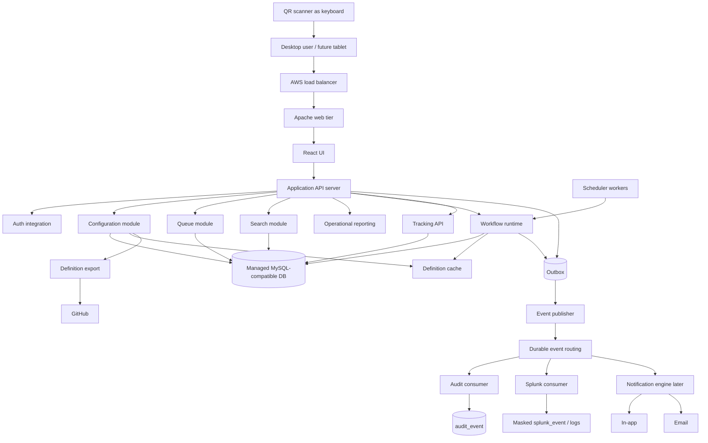

Shaded/future modules are specified but not implemented until their slice. Slice 1 implements the configuration persistence path inside the API server.

## Slice 1 implemented boundaries

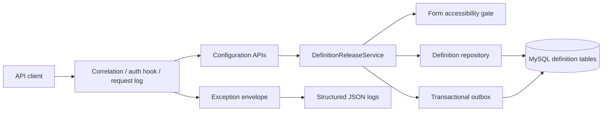

| Process | Slice 1 responsibility | Not yet |
| --- | --- | --- |
| API server | Draft definition CRUD, health, logging, errors | Mail/Workload runtime APIs |
| MySQL 9.7.2 LTS (local Docker) | Definition tables, outbox_event, workflow_instance (including packet parent columns), workflow_stage_visit, workflow_queue_projection, tracking_id_issuance, audit_event, splunk_event | confirm RDS/Aurora GA before production pin |
| Auth | Dev bearer + actor header hook | ICAM/PIV/SAML, RBAC scopes |
| UI | DynamicFormRenderer, QueueScreen, SearchScreen, officer **Workspace** (Workload Type tiles, mail/workload queues, Find a case, prior-stage and parent-mail screens, QR labels, scan-to-open), form/workflow/catalog designers with simulate and semantic diff | Dedicated label printer SDK |
| Workflow runtime | Loader, rule engine, simulate, instance + visits, assign/reassign/release, save draft, execute action, definition lifecycle, queues, Find a case / search, tracking mint, scan, scheduler worker, outbox publisher, bulk actions | Notification delivery, live Splunk HEC |

## Slice 2 definition load path

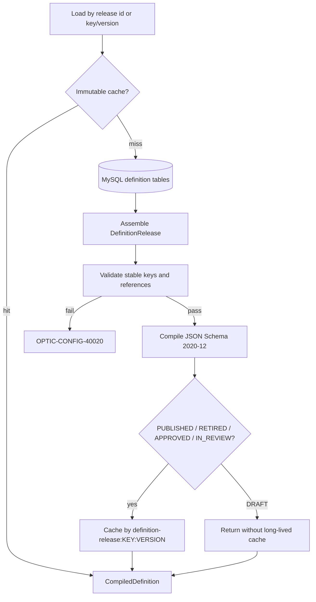

DRAFT releases are compiled on each load because they are mutable. Retired published releases remain loadable for in-flight instances. Load also validates rule operators and JSONPath syntax (`OPTIC-CONFIG-40024`) and compiles MATCHES regexes (`OPTIC-CONFIG-40022` on invalid patterns).

## Slice 3 rule evaluation path

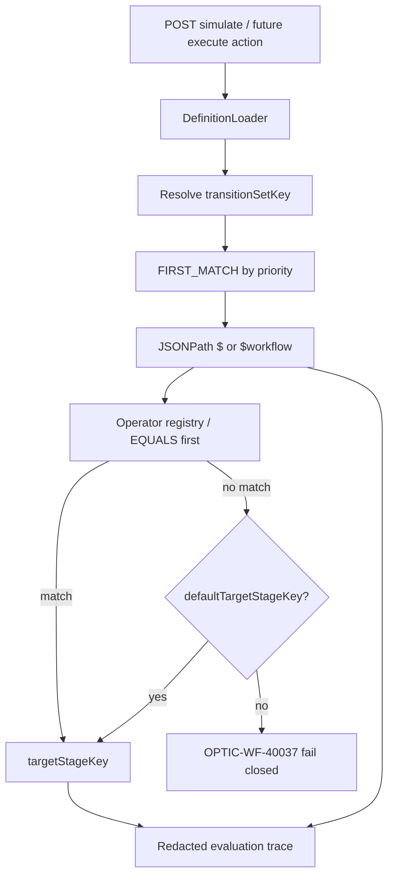

Rules accept `equals` and `EQUALS`. MISSING is distinct from null. Comparisons do not coerce strings to numbers. Evaluation traces omit raw PII and string/object values. Simulation writes no production records.

## Slice 4 instance and stage-visit path

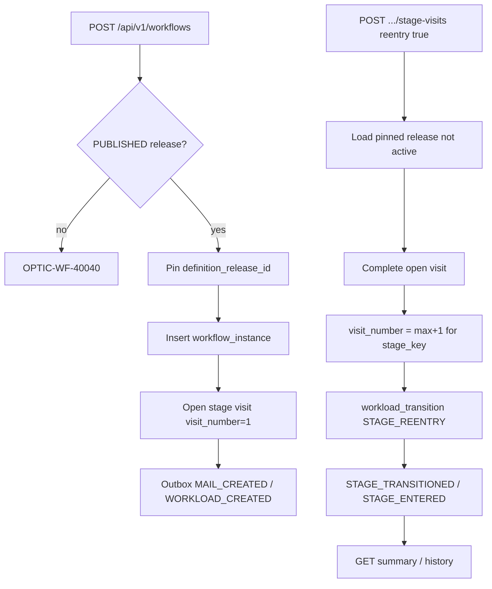

New instances without `version` require `PUBLISHED` (and usually an active pointer). An explicit `version` may pin DRAFT / IN_REVIEW / APPROVED for Designer Try; those rehearsal cases skip queue projection and scheduled actions. Existing instances keep their pinned release after a newer release becomes active. Re-entering a stage increments `visit_number`. `POST .../stage-visits` requires `reentry: true` and writes `workload_transition`; it is a re-entry hook, not a substitute for execute action.

## Slice 5 assignment compare-and-set

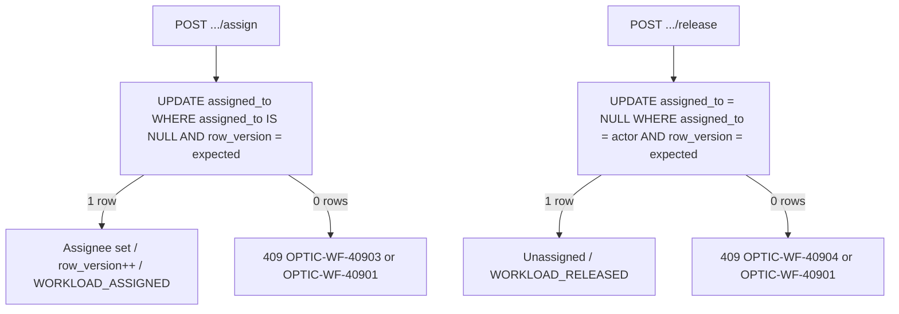

Two overlapping assign-to-self calls on the same unassigned instance produce exactly one success. The open stage visit stores `assigned_to` / `assigned_at`. Supervisor reassignment is Slice 15 (`POST .../reassign`, `WORKLOAD_REASSIGNED`).

## Slice 6 dynamic form runtime

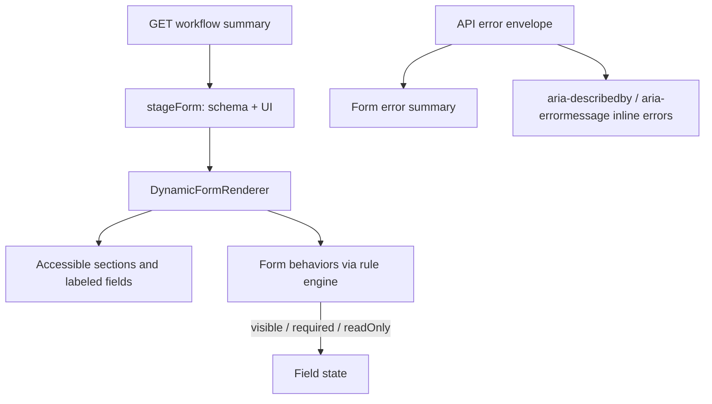

The renderer is a React package in `web/`. GET summary includes `stageForm` and `businessData` from the pinned release.

## Slice 7 save draft

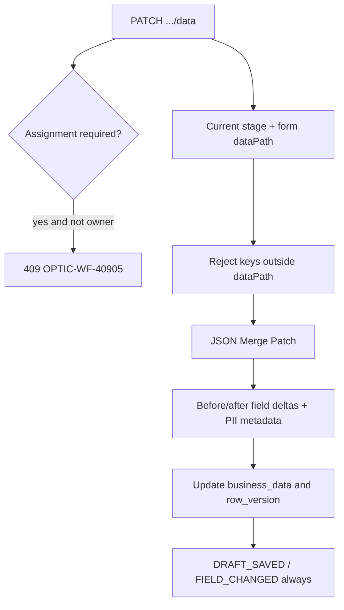

`business_data` lives on `workflow_instance` until Mail/Workload domain tables are the authoritative store. Draft save checks types and formats (`OPTIC-WF-40051`) but does not require complete required fields. `FIELD_CHANGED` is written even when the delta list is empty. Two writers with the same `rowVersion` produce one success and one `OPTIC-WF-40901`.

## Slice 8 execute action

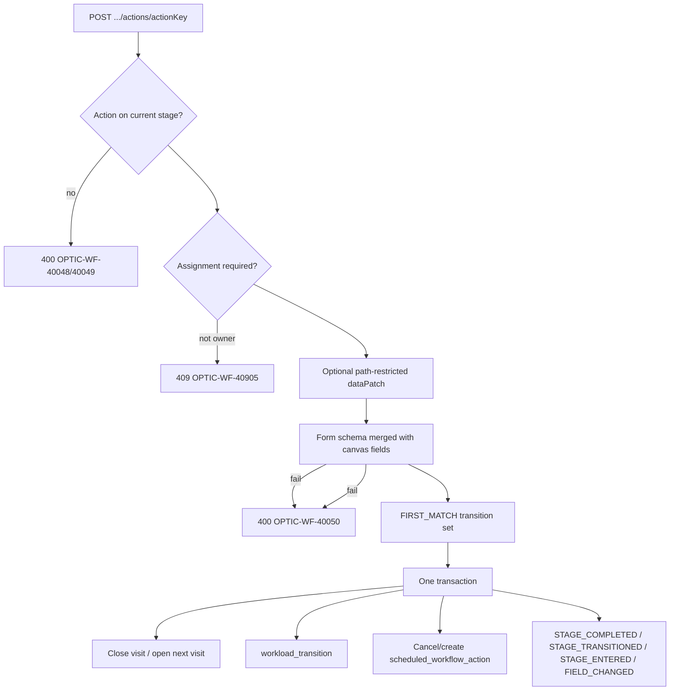

`SAVE` actions reuse draft save. `RELEASE_ASSIGNMENT` reuses release. Complete (`validateStageForm`) compiles a schema from the current canvas fields (dropping removed palette properties) and validates only those properties, so leftover keys from an older schema do not block Complete. Action `comment` is copied onto the outbox payload. Assign, release, draft save, and execute action accept `X-Idempotency-Key` (`OPTIC-WF-40906` on reuse with a different body). WORKLOAD aliases live under `/api/v1/workloads/{trackingId}` and spec-style `/api/v1/workflows/{trackingId}/...`. The scheduler worker leases `scheduled_workflow_action` and executes configured hold expiration.

## Slice 9 configuration lifecycle

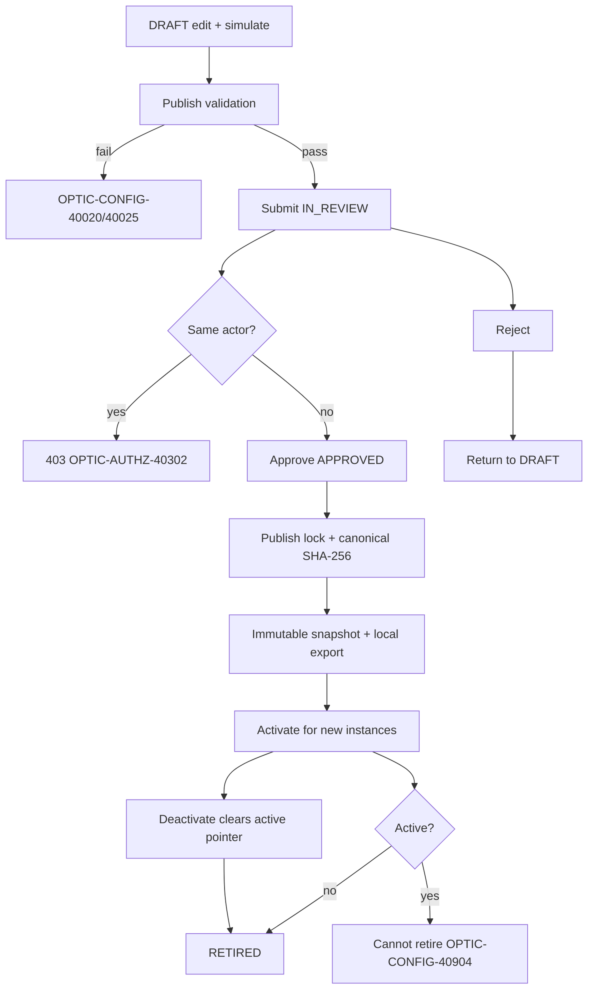

Submit, approve, and publish are separate duties. Publish does not change existing pinned instances. Activate/deactivate only move `definition.active_release_id`. A DRAFT can be deleted (`DELETE .../releases/{version}`); if it is the last release, the definition row is removed so the key can be reused. Local export writes `manifest.yaml`, `workflow.yaml`, `ui/*.yaml`, and `schemas/*.json`. `GET .../export` returns the package + checksum; `POST .../releases/import` installs that package as DRAFT (default) or PUBLISHED (`mode: "PUBLISHED"`) after checksum verify (no auto-activate). GitHub export is not written in this slice. Lifecycle mutations accept `X-Idempotency-Key`.

## Slice 10 configurable queues

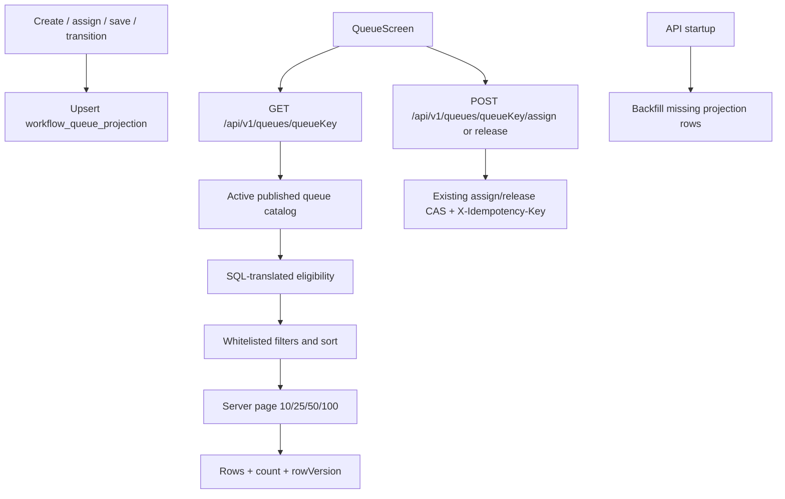

A queue is a view, not a stage. Eligibility is a declarative predicate over projected workflow/system/business columns. Catalog queues may also declare `projectedFields` (fieldKey, label, JSONPath) so form values are copied into `projected_json` for display. Those authored columns are not SQL filters or sorts. Publish rejects unknown columns, unprojected eligibility, and operators that cannot become parameterized SQL (`OPTIC-CONFIG-40026`). Query-time violations use `OPTIC-WF-40060`; unknown queues use `OPTIC-WF-40420`; assign of a non-eligible item uses `OPTIC-WF-40061`. Authorization is applied before rows and counts are returned.

## Slice 11 scheduler worker

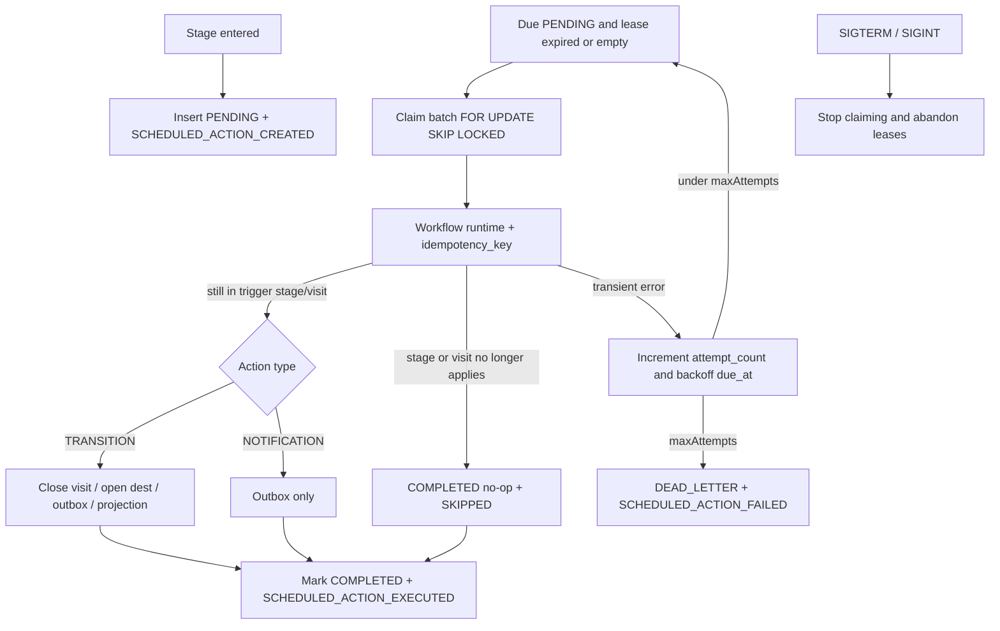

The worker does not scan definition files. Hold period is `scheduledActions` on the pinned Definition Release (`ON_HOLD_EXPIRATION` TRANSITION). `due_at` comes from `delay.source: CONFIG` duration or `FIELD` JSONPath over business data. Runtime verifies the instance is still in the trigger stage and visit; a late duplicate is a safe no-op, not a second transition. Worker calls go through the idempotency store using the row `idempotency_key`. Leases use `lease_owner` / `lease_expires_at`. Retry uses configured `retry.maxAttempts` and EXPONENTIAL backoff; exhausted retries are `DEAD_LETTER`. Shutdown stops new claims, waits for in-flight work, then abandons this worker's leases.

Scheduler codes: `OPTIC-WF-40070` (unknown scheduled action key on the pinned release), `OPTIC-WF-40071` (TRANSITION missing `targetStage`), `OPTIC-WF-40072` (unsupported action type), `OPTIC-WF-40073` (FIELD delay path missing or invalid), `OPTIC-WF-40421` (scheduled row not found), `OPTIC-WF-40907` (lost lease; treated as a skip).

## Slice 12 audit and Splunk pipeline

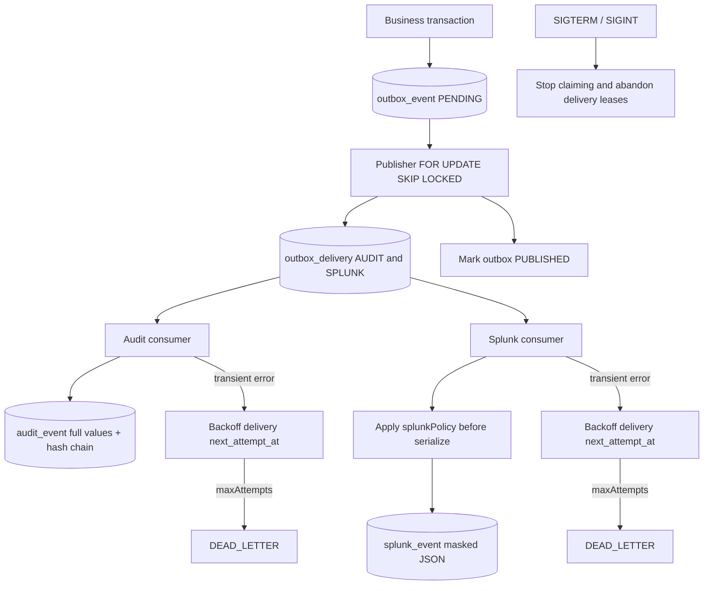

The API does not call Splunk in the request path. The publisher hands each committed outbox row to independent `AUDIT` and `SPLUNK` deliveries. Authoritative `audit_event` stores full `fieldDeltas` plus spec `changes[]` (`fieldKey`, `path`, `classification`, `before`, `after`) and a SHA-256 hash chain per entity partition. Workflow events use `sourceService: workflow-runtime` and include `workflow.stageVisitId`. The Splunk path applies `splunkPolicy` (`MASK` / `KEEP_PREFIX_SUFFIX`, prefix 1 / suffix 3) before serialization. HTTP 403 writes `AUTHORIZATION_DENIED`; unexpected 5xx writes `SYSTEM_ERROR`. Dead-lettered deliveries can be redriven. `npm run migrate` with `DATABASE_ADMIN_USER`/`DATABASE_ADMIN_PASSWORD` strips schema-level `UPDATE`/`DELETE` from `DATABASE_USER` and re-grants them on every table except append-only `audit_event` (MySQL 9 partial revokes are schema-level only). There is no HTTP Event Collector in this slice.

Pipeline codes: `OPTIC-SYS-50010` (outbox publisher failed), `OPTIC-SYS-50011` (audit consumer failed), `OPTIC-SYS-50012` (Splunk consumer failed). Exhausted consumer retries are `DEAD_LETTER` on `outbox_delivery`.

## Slice 13 bulk actions

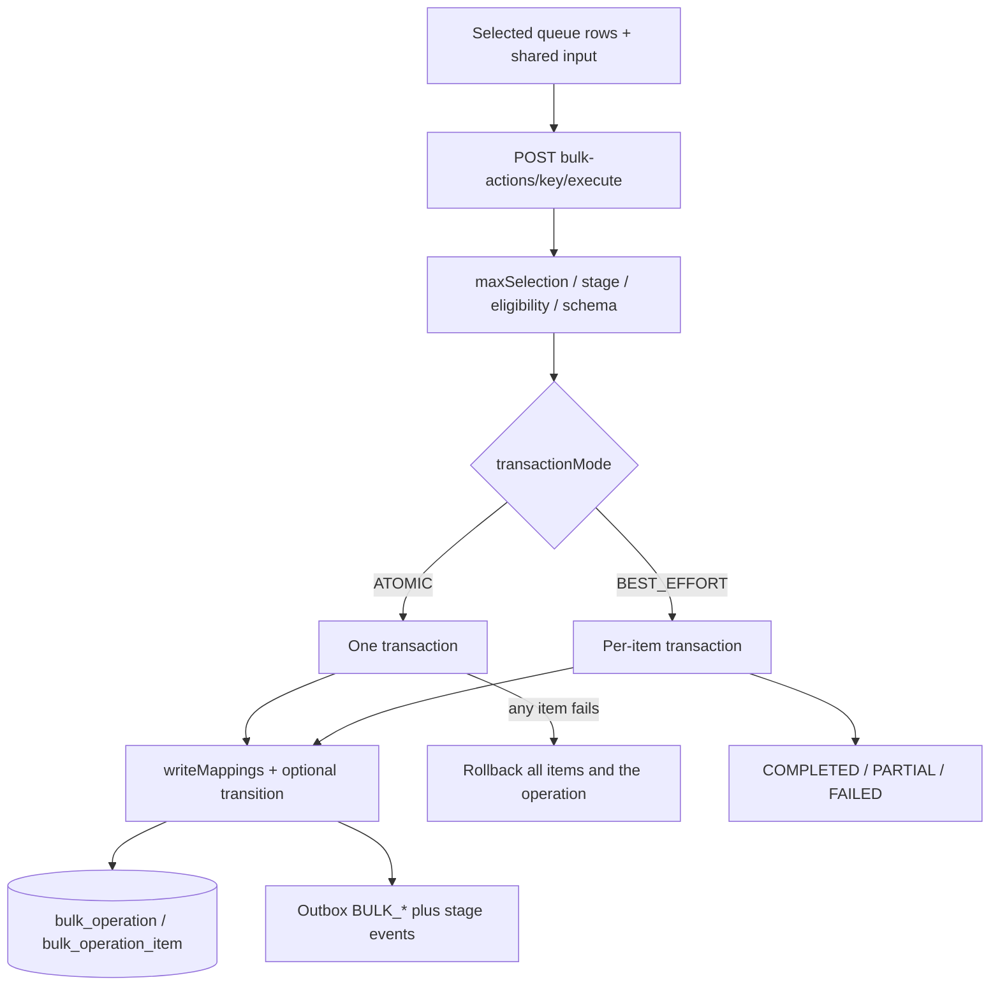

`ATOMIC` applies every selected item in one database transaction. Any item failure rolls back workflow mutations, outbox rows, and the `bulk_operation` record. `BEST_EFFORT` persists the operation first, then commits or fails each item independently. Queue GET includes `bulkActions` from stages that use that queue, omitting actions the actor cannot execute (`canExecuteBulkAction`). Execute and operation GET use `assertCanExecuteBulkAction` / `assertCanReadBulkOperation`. Shared-input labels come from JSON Schema `title`. Eligibility supports `requireUnassignedOrAssignedToCurrentUser` plus `all` / `any` / `not` predicates on `currentStageKey`, `assignedTo`, `entityType`, and `status` (`$currentUser` resolves to the actor). `QueueScreen` shows a selection toolbar only when bulk actions are configured. **Workspace → Live** calls the APIs through the Vite proxy after `npm run seed:bulk` (I-131 shipping plus I-407 live + draft).

Bulk codes: `OPTIC-WF-40080` (unknown bulk action), `OPTIC-WF-40081` (empty or duplicate selection), `OPTIC-WF-40082` (over `maxSelection`), `OPTIC-WF-40083` (mixed pinned releases), `OPTIC-WF-40084` (wrong stage), `OPTIC-WF-40085` (eligibility failed — assigned to someone else or expression mismatch), `OPTIC-WF-40086` (shared input invalid), `OPTIC-WF-40087` (write mapping path invalid), `OPTIC-WF-40430` (operation not found). Events: `BULK_ACTION_STARTED`, `BULK_ITEM_SUCCEEDED`, `BULK_ITEM_FAILED`, `BULK_ACTION_COMPLETED`.

## Slice 14 designers

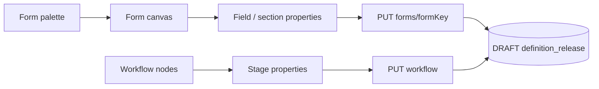

The React designers sit on the existing configuration APIs. Save is offered only while `lifecycleStatus` is `DRAFT`. The form designer is a three-pane palette / canvas / properties layout with preview, form UI JSON, and a JSON Schema editor. SELECT/MULTI_SELECT/RADIO options and behavior `visible` / `required` / `readOnly` effects are edited in Properties. Behaviors and transition `when` clauses use nested `all` / `any` / `not` groups. The workflow designer stores presentation `layout` on nodes (drag or keyboard nudge) without changing execution `order`, and validates unreachable stages plus transition actions that have no destination. Clone-from-version, a form picker, Designer **Try** (`GET /api/v1/workflows?definitionKey=&version=` plus `POST` with an explicit version, including DRAFT), `POST .../simulate`, and `GET .../diff/{from}/{to}` are available on the same workspace. Client-side checks reuse the same accessibility and reference rules the server enforces (`OPTIC-CONFIG-40010` still rejects inaccessible forms).

## Slice 15 catalog designers, search, and reassignment

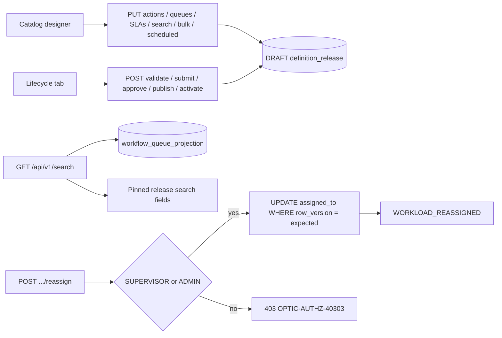

The Designer **Catalog** tab authors actions, queues (including SQL-safe eligibility), SLAs, search metadata, bulk actions, and scheduled actions through the existing DRAFT `PUT` APIs. The **Lifecycle** tab runs validate and the submit → approve → publish → activate path; actor id is entered on that tab so separation of duties is a different `X-Actor-Id`, not an RBAC admin UI. Search fields belong here because `GET /api/v1/search` is driven by the pinned release `search_definition` plus always-on tracking ID and receipt number. `q` matches tracking ID only (scan payload or contains). `receiptNumber` is a separate prefix on the projected receipt column. The MySQL provider queries `workflow_queue_projection` with `LIKE` (no JSON CAST); matching is refined in the search service. Application logs emit `search.executed` with hit counts only — never `q` or matched values.

`POST /api/v1/workflows/{entityType}/{trackingId}/reassign`, WORKLOAD aliases, and `POST /api/v1/queues/{queueKey}/reassign` move assignment to another officer. Officers still assign-to-self only. Reassignment is optimistic on `row_version` (`OPTIC-WF-40908` on stale version) and does not require the row to be unassigned. Empty `assignedTo` is `OPTIC-WF-40090`; assigning to the current assignee is `OPTIC-WF-40091`. Each stage’s `assignmentPolicy` controls **Allow assign**, **Allow reassign**, and **Allow release**. Omitted flags infer assign/reassign off on a terminal stage and on otherwise; release defaults on. A forbidden assign or reassign is `OPTIC-WF-40092`; a forbidden release is `OPTIC-WF-40093`. Queue row actions and the case **Release** button follow the same flags. The outbox event is `WORKLOAD_REASSIGNED` with `previousAssignedTo`. Queue **Reassign** is on Workspace queue screens when the stage allows it; the button opens a dialog to type the officer who should receive the case. **Find a case** sits at the top of the Workspace main pane (not a separate header tab). Workspace **Working as** is a typed name or email that sets `X-Actor-Id` for assign and release. Reassignment sends `X-Actor-Roles: SUPERVISOR`. The bulk seed assigns `W-DEMO-SHIP-1` to `officer@example.gov` and `W-DEMO-SHIP-2` to `jordan.officer@example.gov`.

## Slice 16–17 officer Workspace

The navy header is **Workspace** and **Designer**. Workspace is the officer product: pick a **Workload Type** (mail + workload members of the same kind, e.g. I-407), then mail-item vs workload queues. **Try** lists saved drafts and pins an explicit `version` so DRAFT instances can be walked (they skip Live projection and the scheduler). **Live** uses activated queues. **Find a case** sits at the top of the main pane (always visible) with **Tracking ID** (scan payload or contains) and **Receipt number** (prefix on the projected receipt). Workload Type and queue nav stay on the left. Results are a stacked list of buttons — the whole row opens the case; there is no Open column and no horizontal table scroll. Each queue row and search result has a row number. **Clear** empties the fields and removes the list. A full QR or exact tracking ID opens immediately. Find a case can open a Try draft by tracking ID / scan even when it is not in Live projections.

Mail Complete can spawn workload instances (`spawnDefinitionKey`) and copy matching repeating-row fields onto the child’s first form by normalized leaf path (for example mail-row `workloadStatus` → workload **Workload Status**), mapping choice values onto the target options. Opening a workload recovers parent mail screens when that tracking number is listed on the mail Doc Prep form.

Designer **Try** remains the single-definition walk-through for the opened draft. Use Workspace **Try** to rehearse the officer path across the whole workload type.

## Slice 18 labels, tracking mint, and scan

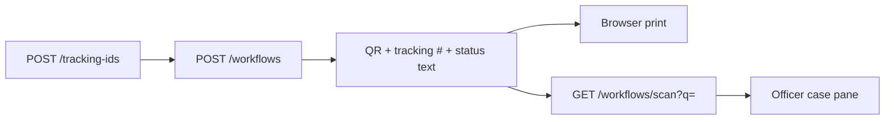

Live **New mail arrives** mints a short Crockford id (`M-` / `W-` + 10 chars) from `POST /api/v1/tracking-ids` (`MAIL` or `WORKLOAD`) and stores it on `tracking_id_issuance` (`012_tracking_id.sql`). Packet parent columns are `parent_entity_type` / `parent_tracking_id` on `workflow_instance` (`011_workflow_packet_parent.sql`). Try still mints a local id of the same shape. The case pane shows stickers for this case plus packet parent/children. QR payload is `OPTIC:MAIL:{id}` or `OPTIC:WORKLOAD:{id}`. `GET /api/v1/workflows/scan?q=` accepts that payload or a bare tracking id. Status is printed as text (not color-only). Dedicated printer SDKs are not in this slice. Application logs redact receipts and A-Numbers by field name and by value shape. The UI error summary shows the same API envelope (`summary`, `details`, `referenceId`) as the JSON response.

## Definition persistence model

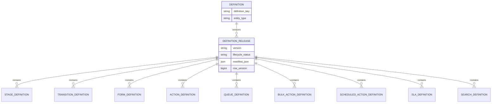

Published releases are immutable. Slice 1 only writes `DRAFT`.

## Request, exception, and log flow

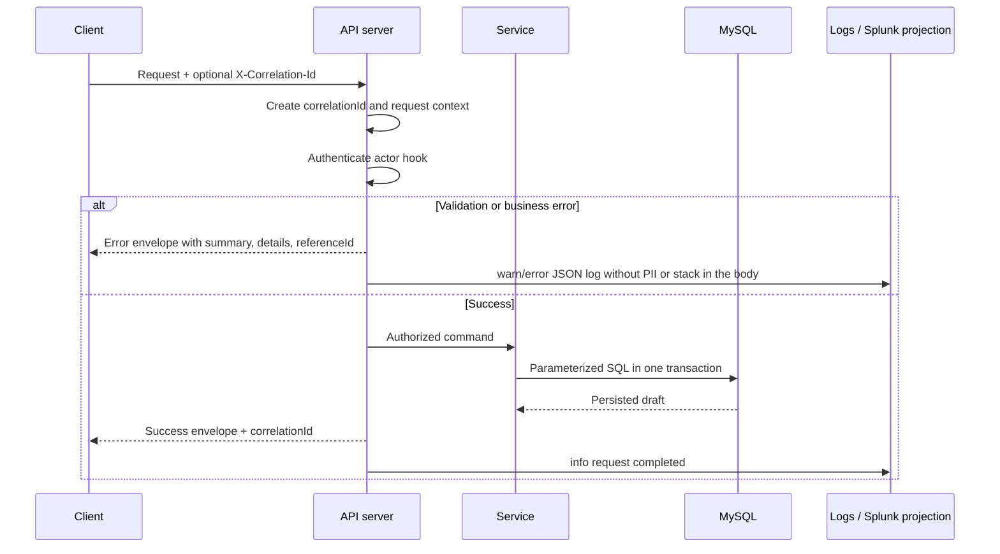

See [logging-and-errors.md](./logging-and-errors.md) and [accessibility-508.md](./accessibility-508.md).

## Accessibility enforcement path

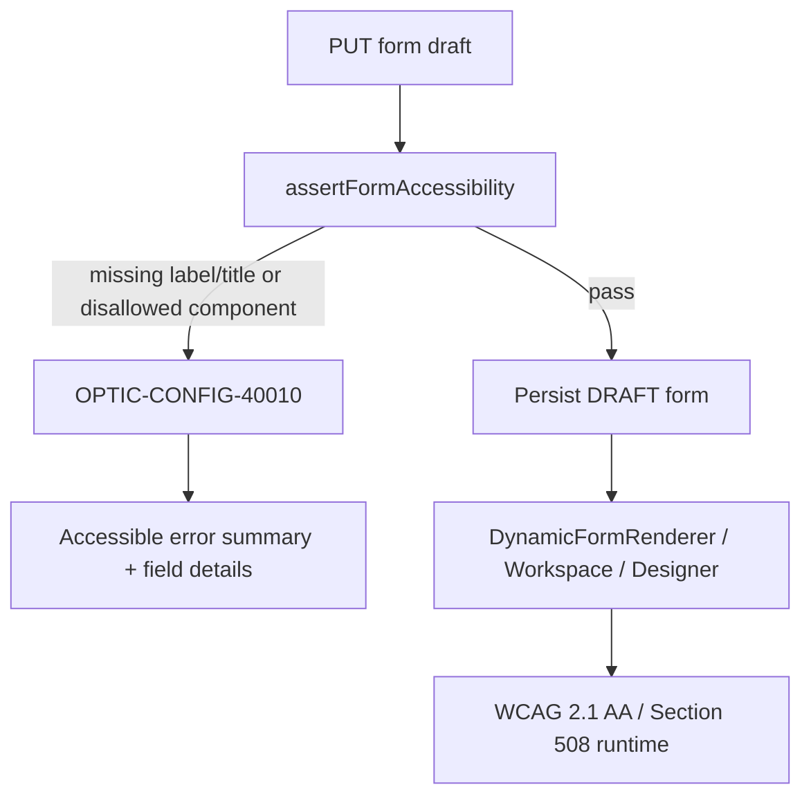

Configuration that cannot produce an accessible UI is rejected before it is stored. Officer and Designer surfaces follow the WCAG 2.1 AA / Section 508 checklist in [accessibility-508.md](./accessibility-508.md).
