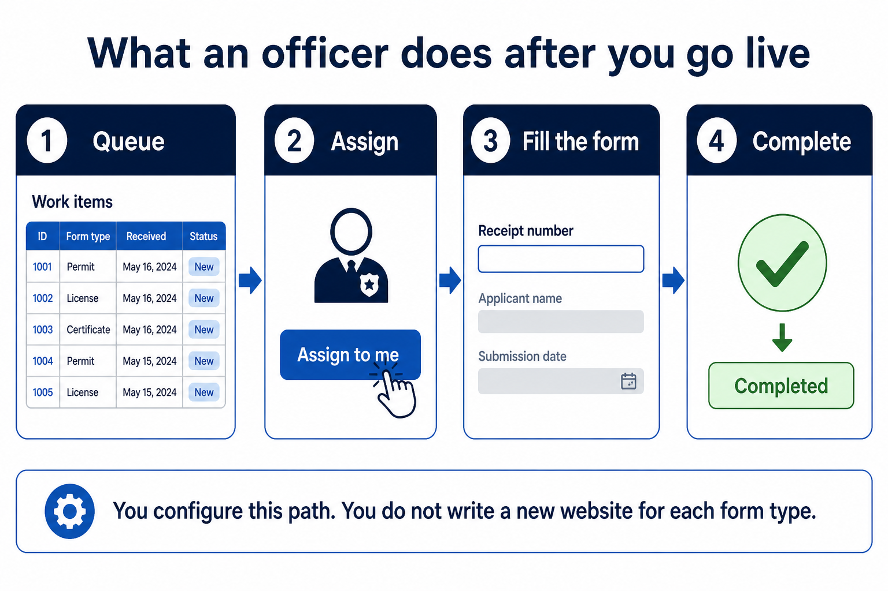
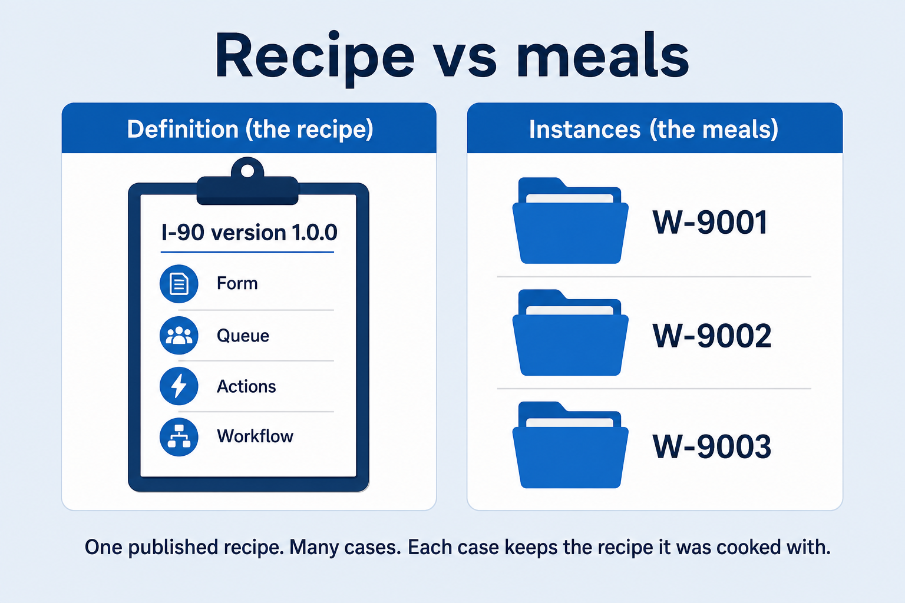
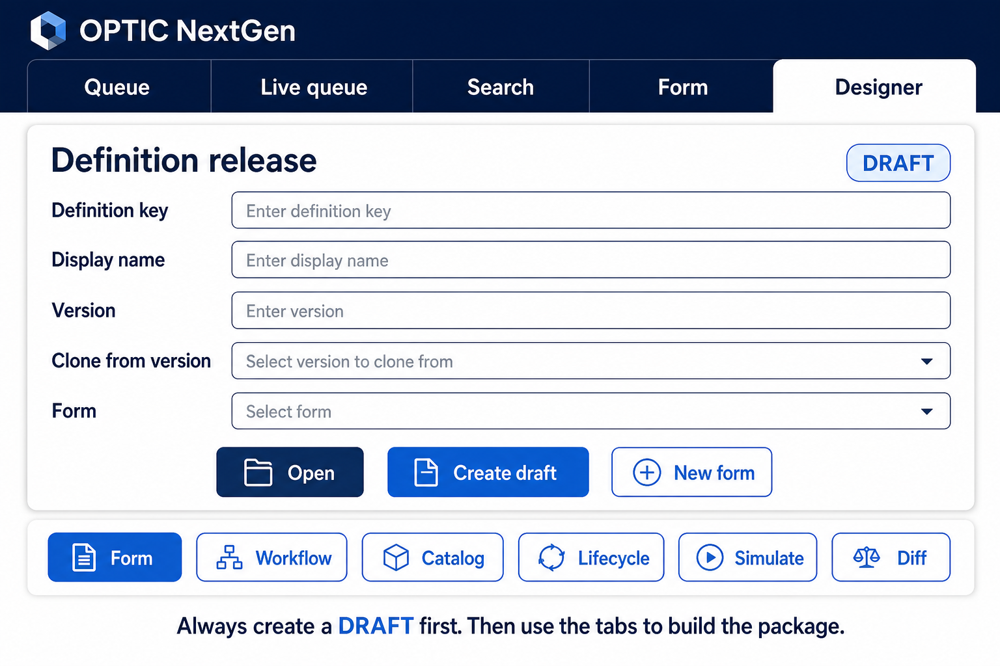
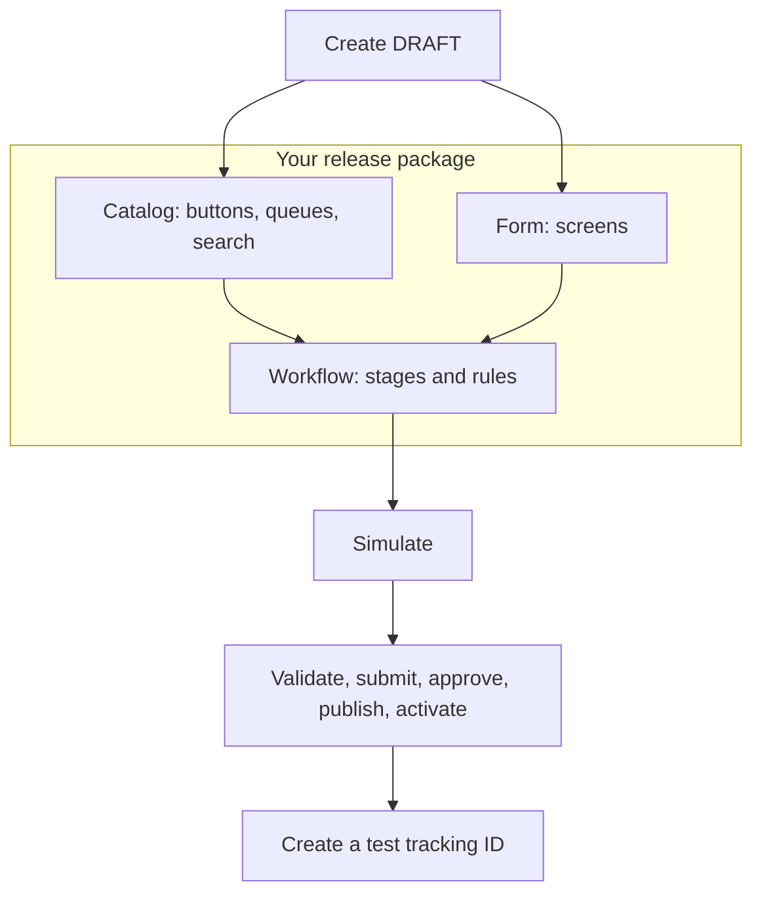
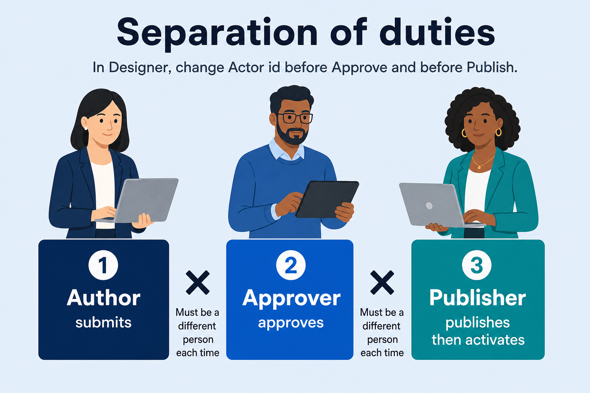
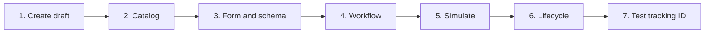
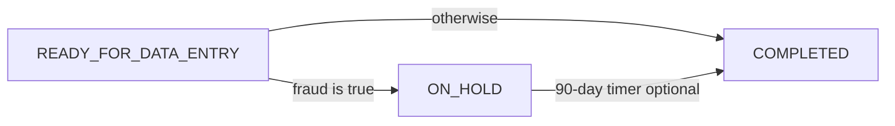
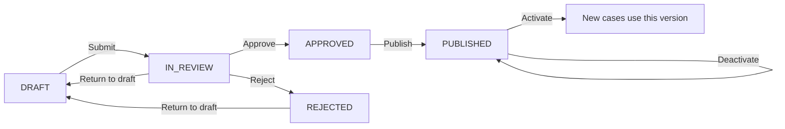

# User guide: onboard a new workload from scratch

This is the full walkthrough for creating a **new type of work** in OPTIC v2.0 — for example a new I-90, I-131, or I-765 process — **without writing application code**.

You will click through the **Designer** in the web demo, fill in names and rules, save a **draft**, send it through **review**, and **activate** it so officers can receive real tracking IDs. Think of it as publishing a recipe the kitchen will follow, not building a new kitchen.

**You do not need to be a software engineer** to follow the Designer steps. Officers work in **Workspace**. Authors work in **Designer**. Where this guide shows `curl` commands or HTTP paths, those are optional — for engineers, testers, or anything that still has no screen.

**Audience:** configuration authors, reviewers, publishers, and the engineers who support them.  
**Current product slice:** Slice 18 (officer **Workspace**, Workload Type, Find a case, tracking-id mint, QR labels, scan-to-open; form/workflow/catalog/lifecycle designers; supervisor reassignment).  
**Companion docs:** [Officer Workspace user guide](./officer-workspace-user-guide.md) (officers), [Designer user guide](./designer-user-guide.md) (plain-language authoring), [architecture overview](../architecture/overview.md), [logging and errors](../architecture/logging-and-errors.md), [WCAG 2.1 AA / Section 508](../architecture/accessibility-508.md).

---

## How to use this guide

Read it in this order the first time:

1. [What you are building](#1-what-you-are-building) — the big picture and pictures.
2. [Tour of the Designer](#tour-of-the-designer) — where to click.
3. [Recommended authoring order](#6-recommended-authoring-order) — do not skip this; the product expects pieces to exist before you point at them.
4. [Worked example](#20-worked-example-a-linear-data-entry-workload) — one complete I-90-style path you can copy.
5. Come back to sections 8–16 when you need field-by-field detail.

Keep a notepad for **keys** you invent (`I_90`, `READY_FOR_DATA_ENTRY`, `SAVE_DRAFT`). OPTIC is strict about spelling. A queue named `Ready_for_data_entry` will be rejected; `READY_FOR_DATA_ENTRY` will be accepted.

---

## Table of contents

1. [What you are building](#1-what-you-are-building)
2. [What the designers cover, and what still requires APIs](#2-what-the-designers-cover-and-what-still-requires-apis)
3. [Prerequisites and local environment](#3-prerequisites-and-local-environment)
4. [Actors, headers, and concurrency](#4-actors-headers-and-concurrency)
5. [Glossary and naming rules](#5-glossary-and-naming-rules)
6. [Recommended authoring order](#6-recommended-authoring-order)
7. [Create the definition and a DRAFT release](#7-create-the-definition-and-a-draft-release)
8. [Catalog: actions, queues, SLAs, search, bulk, and scheduled](#8-catalog-actions-queues-slas-search-bulk-and-scheduled)
9. [Form screens: elements, properties, validation, and behaviors](#9-form-screens-elements-properties-validation-and-behaviors)
10. [JSON Schema: the business-data contract](#10-json-schema-the-business-data-contract)
11. [Workflow: stages, assignment, and transition rules](#11-workflow-stages-assignment-and-transition-rules)
12. [JSONPath, operators, and evaluation rules](#12-jsonpath-operators-and-evaluation-rules)
13. [Simulate transitions, try as officer, and diff versions](#13-simulate-transitions-and-diff-versions)
14. [Bulk actions and scheduled actions](#14-bulk-actions-and-scheduled-actions)
15. [Accessibility gates you cannot skip](#15-accessibility-gates-you-cannot-skip)
16. [Validate, submit, approve, publish, and activate](#16-validate-submit-approve-publish-and-activate)
17. [Create the first live instance and operate it](#17-create-the-first-live-instance-and-operate-it)
18. [Queues, Find a case, tracking, and supervisor reassignment](#18-queues-find-a-case-tracking-and-supervisor-reassignment)
19. [Versioning, cloning, retiring, and in-flight work](#19-versioning-cloning-retiring-and-in-flight-work)
20. [Worked example: a linear data-entry workload](#20-worked-example-a-linear-data-entry-workload)
21. [End-to-end checklist](#21-end-to-end-checklist)
22. [Error codes you will see while authoring](#22-error-codes-you-will-see-while-authoring)
23. [Known product limits](#23-known-product-limits)

---

## 1. What you are building

Imagine today’s process: an officer opens a **work list** (a queue), **assigns** a case to themselves, fills in a **screen** (receipt number, dates, checkboxes), clicks **Save** or **Complete**, and the case moves to the next **stage** (or sits on hold until a timer expires).

In OPTIC, you are not asking a developer to build a new website for each form type. You are publishing a **definition release**: a versioned package that *is* that process.



**What success looks like for officers**

They work in **Workspace** (not Designer). They pick a **Workload Type** (for example I-407), then mail-item or workload queues.

1. **Queue** — they see unassigned work for this stage.
2. **Assign** — they take an item (“Assign to me”).
3. **Fill the form** — they enter data on the stage screen you designed.
4. **Complete** — rules decide the next stage (for example Completed, or On hold if fraud is flagged).
5. **Find a case / labels** — they scan a QR or type a tracking ID (or a receipt prefix) and print stickers with tracking # plus status as text.

You configure that path. You do not write a new website for each form type.

Identity is `(entityType, trackingId)`. `entityType` is **MAIL** or **WORKLOAD**. A named type can be two definitions (I-407 = `I_407_MAILITEM` + `I_407_WORKLOAD`). Mail arrives, officers register it, Complete can spawn 1..N workloads, then they print QR + tracking # + status. Repeatable sections and spawn are **Mail only**.

### Definition, release, and instance (plain language)

Three words appear everywhere. They are not interchangeable.

| Word | Everyday meaning | Example |
| --- | --- | --- |
| **Definition** | The *kind* of work. The name never changes after you create it. | `I_90` — Application to Replace Permanent Resident Card |
| **Release** | A *version* of that kind of work. Drafts can be edited. After publish, that version is frozen. | `I_90` version `1.0.0` |
| **Instance** | One real case with a tracking ID. It is cooked from a published recipe and **keeps that recipe forever**, even if you later publish `1.1.0`. | `W-9001` |



A definition has an `entityType` of `WORKLOAD` (or `MAIL`). Officers never “open a React page you coded.” They open a **queue**, **assign** an item, see the **stage form** from the **pinned** release, **save draft** or **execute an action**, and the rule engine chooses the next stage.

### What is inside a release?

A release is an assembled package. You will fill these pieces in Designer, usually in the order in [section 6](#6-recommended-authoring-order).

| Piece | In everyday words | Purpose |
| --- | --- | --- |
| `schema` | The data contract | JSON Schema 2020-12 for `businessData` — what fields exist and what “complete” means |
| `forms` | The screens | Sections, fields, labels, and when fields show or become required |
| `workflow` | The process map | Stages, who must be assigned, and rules that choose the next stage |
| `actions` | The buttons | SAVE (keep working), TRANSITION (I’m done), RELEASE_ASSIGNMENT (return to queue) |
| `queues` | The work lists | Filtered views of work, **not** the same thing as a stage |
| `slas` | The clock | Target hours and breach severity on a stage |
| `search` | Find-a-case extras | Catalog fields in addition to always-on tracking ID and receipt number |
| `bulkActions` | Do-this-to-many | Multi-select operations on a queue |
| `scheduledActions` | Timers | Holds, nudges, delayed transitions |

**Queue versus stage (easy to mix up):** a **stage** is where the case *is* in the process (“Ready for data entry”). A **queue** is a *list* of cases that match a filter (usually “current stage equals Ready for data entry”). Many stages can share one queue; one stage usually has one queue.

---

## Tour of the Designer

Start the web demo (`npm run dev:web`). The navy header has two products:

| Header button | What it is |
| --- | --- |
| **Workspace** | Officer product: pick a **Workload Type** (I-407, I-90, …) on the left, then mail-item vs workload queues. **Try** walks the newest draft’s authored queues; **Live** walks the activated published snapshot’s authored queues (same list if Live was published from that draft; they diverge after the draft changes). **Find a case** sits at the top of the main pane with **Tracking ID** (scan payload or contains) and **Receipt number** (prefix). Results are stacked buttons with row numbers — click the row to open. **Clear** empties the fields and list. |
| **Designer** | Where you author configuration. |



The top of Designer is always **Definition release**:

- **Definition key** — machine name, uppercase (`I_90`).
- **Display name** — human name officers can read.
- **Entity type** — **Workload** (a form case) or **Mail item** (an envelope that can spawn workloads). Stored when you Create draft; Open shows the saved type.
- **Version** — `1.0.0` style number.
- **Clone from** — optional. Pick a saved release to copy into this new DRAFT. Same definition + new version iterates; a **new** definition key copies another workload as a starting point.
- **Form** — which screen you are editing if you have more than one.
- **Open** — lists saved definition releases (drafts and published). Choose one to load.
- **Create draft** — create the definition (if needed) and a new DRAFT.
- **Delete draft** — permanently remove the opened DRAFT (leftover clones, unused experiments) and any Try cases cooked from that draft. Disabled unless a DRAFT is open. If it was the last release for that key, the definition is removed so you can recreate the key.
- **New form** — add another blank screen to this draft.
- **Delete form** — remove the selected screen from this DRAFT (local-only until it has been saved; saved forms are deleted on the release). Clear the form key on any stages that still point at it.

A status line shows **DRAFT** (or IN_REVIEW, PUBLISHED, …). **Save is disabled unless the status is DRAFT.**

Tabs under that line:

| Tab | You use it to |
| --- | --- |
| **Form** | Draw the officer screen |
| **Schema** | Merged mail-item or workload JSON Schema |
| **Workflow** | Draw stages and “what happens next” |
| **Catalog** | Buttons, queues, clocks, search, bulk, timers |
| **Try** | Walk the saved draft as an officer before publish |
| **Lifecycle** | Validate, submit, approve, publish, activate |
| **Simulate** | Dry-run a rule without creating a real case |
| **Diff** | Compare two versions for reviewers |



---

## 2. What the designers cover, and what still requires APIs

Open `npm run dev:web` → **Designer**. The workspace talks to the API through the Vite `/api` proxy (the browser calls `/api/...` and the web server forwards to port 3000). You do not need to know that to click **Save draft**, but if Save fails with a “not reachable” message, the API is not running.

| Designer tab | You can author | Saved with (for engineers) |
| --- | --- | --- |
| **Form** | Title, formKey, dataPath, sections, fields, SELECT options, behaviors (`visible` / `required` / `readOnly`), UI JSON, JSON Schema | `PUT .../forms/{formKey}` then `PUT .../schema` when schema is present |
| **Workflow** | Stages, canvas layout, assignment, form/queue/SLA/action keys, transition sets and rules | `PUT .../workflow` |
| **Catalog** | Actions, queues (including eligibility), SLAs, search, bulk actions, scheduled actions | `PUT .../actions/{key}`, `.../queues/{key}`, `.../slas/{key}`, `.../search`, `.../bulk-actions/{key}`, `.../scheduled-actions/{key}` |
| **Lifecycle** | Validate, submit, approve, reject, return-to-draft, publish, retire, activate, deactivate, export, import | `POST .../validate`, `.../submit`, `.../approve`, `.../reject`, `.../return-to-draft`, `.../publish`, `.../retire`, `.../activate/{version}`, `.../deactivate/{version}`, `GET .../export`, `POST .../releases/import` |
| **Definition release** (header) | Delete an opened DRAFT | `DELETE .../releases/{version}` |
| **Try** | Officer walk-through: stage queue → assign → form → next queue | `POST /api/v1/workflows` with `version`, then assign / PATCH data / actions |
| **Simulate** | Dry-run a saved transition set against JSON | `POST .../simulate` |
| **Diff** | Semantic changes between two versions | `GET .../diff/{from}/{to}` |

**Not in the Designer UI today** (use **Workspace**, the APIs, or a later app shell):

- Officer queues, Find a case, labels, and Live intake live on **Workspace**, not on Designer tabs. Designer **Try** is the single-definition walk-through for the opened draft. Workspace **Try** is the officer path across the whole Workload Type (mail + workload).
- Designer / Workspace **Try** cases skip Live projection and the scheduler. They do **not** appear on Workspace **Live** queues. **Find a case** can still open a Try draft by tracking ID or scan payload; receipt prefix search only hits Live projections.
- GitHub export, notification delivery, live Splunk HEC, dedicated printer SDKs, and RBAC administration.

Designer **Save** still uses `X-Actor-Id: configurator@example.gov`. Lifecycle **Actor id** is a **separate** field so approve/publish can satisfy separation of duties without a user-admin screen. That is why you will type a different email into **Actor id** between Submit, Approve, and Publish.

---

## 3. Prerequisites and local environment

Ask an engineer if this section looks like “computers.” You only need the Designer in a browser **after** these are running.

### Software

- Node.js 20 or newer
- Docker (MySQL 9.7.2 LTS published on your machine as port **3307**, not 3306)
- Two terminal windows: one for the API, one for the web demo

### Start (what each line is doing)

```bash
cp .env.example .env          # copy settings if you have never done this
docker compose up -d mysql    # start the database in the background
npm install                   # first time only: download libraries
npm run migrate               # create/update tables
npm run dev                   # start the API on http://127.0.0.1:3000
# other terminal
npm run dev:web               # start the UI; open the URL it prints (often 5173)
```

Optional: `npm run seed:bulk` publishes a **shipping** example (`I_131_BULK`) and creates `W-DEMO-SHIP-1` (`officer@example.gov`) / `W-DEMO-SHIP-2` (`jordan.officer@example.gov`) so **Workspace → Live** can show two assignees after activate. It also seeds **I-407** (`I_407_MAILITEM` + `I_407_WORKLOAD`): published `1.0.0` for Live, draft `1.1.0` for Designer / Try, and demo cases `M-DEMO-I407-1` / `W-DEMO-I407-1`. Type any name or email in **Working as**. **Reassign** asks who should receive the case. That seed is **not** your new I-90 definition. Skip it if you are only authoring. Use `npm run seed:i407` to seed only I-407.

Health (paste into a browser or ask an engineer):

- `GET http://127.0.0.1:3000/health/live` — the process is up
- `GET http://127.0.0.1:3000/health/ready` — the process **and** the database are reachable

The web app proxies `/api` and `/health` to the API port (`PORT` in `.env`, default 3000). Designer **Open** / **Create draft** / **Save draft** fail if the API is down, or if something else already owns that port (Open WebUI in Docker on 3000 is a common local conflict). In that case set `PORT=3001` in `.env` and restart both `npm run dev` and `npm run dev:web`.

### After database changes

If you pull schema changes from git, run `npm run migrate` again. Packet parent columns are `011_workflow_packet_parent.sql` (`parent_entity_type` / `parent_tracking_id` on `workflow_instance`). Live tracking mint is `012_tracking_id.sql` (`tracking_id_issuance`). Search and reassignment still use `workflow_queue_projection` / `workflow_instance`.

---

## 4. Actors, headers, and concurrency

You can skip the HTTP headers if you stay in Designer — except **Lifecycle → Actor id**, which you **must** change between people.

Dev authentication (production ICAM/PIV/SAML is not wired yet) looks like this for engineers:

```http
Authorization: Bearer dev-token
X-Actor-Id: author@example.gov
X-Actor-Name: Author
X-Correlation-Id: optional-trace-id
X-Idempotency-Key: optional-uuid
X-Actor-Roles: CONFIGURATOR
```

If `X-Actor-Roles` is omitted, the API defaults to `CONFIGURATOR`. Supervisor reassignment needs `SUPERVISOR` or `ADMIN`.

### Why three different people?



This is **separation of duties**. The same human must not submit a configuration and then approve their own work, or approve and then publish, in this product.

| Step | Typical actor id to type | Same person as the previous step? |
| --- | --- | --- |
| Author / submit | `author@example.gov` | — |
| Approve | `approver@example.gov` | Must be a **different** Actor id or you get `OPTIC-AUTHZ-40302` |
| Publish / activate | `publisher@example.gov` | Must differ from the approver |

In Designer, only the **Lifecycle** tab’s **Actor id** box controls those steps. Ordinary **Save draft** still saves as `configurator@example.gov`.

### Stale saves (`rowVersion`)

Every successful save bumps a number called **row version**. The next save must send the latest number. If two people (or Designer plus `curl`) save over each other, the second save fails with a conflict (`409`).

**What you should do:** after each save, glance at the status line. If you used `curl` as well as Designer, click **Open** so the workspace reloads the latest version.

**Idempotency (engineers):** send `X-Idempotency-Key` on assign, reassign, release, draft save, execute action, bulk execute, and lifecycle posts. Reusing a key with a **different body** is `OPTIC-WF-40906`.

---

## 5. Glossary and naming rules

### Stable keys (the spelling rule)

Most identifiers must match this pattern: start with a letter, then only uppercase letters, digits, and underscores. Everyday English: **UPPERCASE_SNAKE_CASE**.

| Kind | Example | Wrong |
| --- | --- | --- |
| Definition | `I_90`, `I_131_TRAVEL` | `I-90`, `i90` |
| Form | `I90_DATA_ENTRY` | `i90DataEntry` |
| Section | `APPLICANT` | `Applicant` |
| Field | `RECEIPT_NUMBER` (becomes HTML `id="field-RECEIPT_NUMBER"`) | `receipt-number` |
| Stage | `READY_FOR_DATA_ENTRY` | `Ready for data entry` |
| Action | `COMPLETE_DATA_ENTRY` | `completeDataEntry` |
| Queue, SLA, transition set, rule, bulk, scheduled | same rule | mixed case |

Versions are **semver**: `MAJOR.MINOR.PATCH` such as `1.0.0` or `0.1.0`. `OPTIC-CONFIG-40001` / `40002` reject bad keys and versions.

Do not reuse a `fieldKey` on the same form. Duplicate keys fail accessibility validation (`OPTIC-CONFIG-40010`).

When you **invent** a key (new form, new action, new stage), you type it. When a property **points at** something that already exists — a stage’s form, queue, SLA, or actions, or a Catalog action’s transition set — Designer shows a dropdown or checklist so you cannot mistype the key. Lists stay empty until you save the referenced item on its own tab.

### JSONPath (where a field lives in the data)

A **path** is an address inside the case folder.

Allowed:

- `$.dataEntryDetails.receiptNumber` — a value the officer typed (business data)
- `$workflow.currentStageKey` — something the system already knows (stage, assignee, tracking ID)

Not allowed: `..`, `*`, `@`, or script filters. Paths must start with `$` or `$workflow`. “Missing” (never saved) is not the same as `null` (saved as empty).

### Form `dataPath`

Each form has a **dataPath** such as `$.dataEntryDetails`. That is the *folder* this screen’s ordinary fields write into.

When an officer saves a draft, writes outside that folder are rejected (`OPTIC-WF-40047`), **except** shared entity roots:

| Definition | Shared root | Example field Path |
| --- | --- | --- |
| WORKLOAD | `$.workload` | `$.workload.workloadStatus` |
| MAIL | `$.mailItem` | `$.mailItem.receivedDate` |

Put those absolute paths on the field **Path** property. Any stage form may host the control; the value stays at the same place on the case when you move the field from Data Entry to Scanning later. You do **not** need a blank form whose dataPath is `$.workload`.

Ordinary fields stay relative to the form folder: `$.receiptNumber` on a form with dataPath `$.dataEntryDetails` stores `businessData.dataEntryDetails.receiptNumber`.

---

## 6. Recommended authoring order

Work in this order so names exist before you point at them. If you attach a form to a stage before the form exists, validation later fails with `OPTIC-CONFIG-40020` (“I don’t know that key”).

1. Create definition + DRAFT release (empty children are allowed).
2. **Catalog → Actions** (at least one `SAVE` and one `TRANSITION`).
3. **Catalog → Queues** (eligibility tree on the same screen — see §8).
4. **Catalog → SLAs** if the stage will clock time.
5. **Catalog → Search** fields.
6. **Catalog → Bulk / Scheduled** if the workload needs them.
7. **Form** (sections, fields, options, schema, behaviors).
8. Release-level **schema** (saved automatically from the form Schema pane on Save).
9. **Workflow** (stages: pick form/queue/SLA/actions from the lists). Each stage gets its own **From {stage}** Complete rules; split shared rules if a later stage still follows an earlier one.
10. Return to **Catalog → Actions** only if you need a different TRANSITION button than Complete.
11. **Simulate**, then **Lifecycle → Validate**.
12. **Lifecycle** submit → approve → publish → activate (change **Actor id** between steps).
13. Create a test instance, assign, save, complete, search.



---

## 7. Create the definition and a DRAFT release

### In the Designer (click by click)

1. In the header, click **Designer**.
2. In **Definition key**, type `I_90` (it uppercases as you type).
3. In **Display name**, type a sentence officers would recognize, for example `I-90 Application to Replace Permanent Resident Card`.
4. Leave **Entity type** as **Workload**. Use **Mail item** only for an envelope that can spawn one or more workloads.
5. In **Version**, type `1.0.0` (or `0.1.0` while you are practicing).
6. Leave **Clone from** as **None — blank draft** the first time you invent a workload.
7. Click **Create draft**.

**What you should see:** the status line something like `I_90 1.0.0 is DRAFT (rowVersion …)`. Save buttons on the other tabs become available.

**If it fails:** “API is not reachable” means `npm run dev` is not running, or the UI is talking to the wrong port. Duplicate definition keys are ignored (`OPTIC-CONFIG-40901`) so Create draft can also *reopen* an existing key. Use **Open** if the version already exists and you just want to load it. Use **Delete draft** on an opened DRAFT to throw a leftover away (for example after cloning `I_407` to `I_407_WORKLOAD`).

Only `DRAFT` enables Save. Use the **Lifecycle** tab to move the opened release through review and publish. Published releases are **read-only** in the workspace — you cannot “tweak one field” on 1.0.0 after publish; you clone 1.0.1.

### Copy another workload (similar forms)

If I-131 is mostly the same as I-90, do not rebuild every queue and field. Create a **new** definition from the old one:

1. **Definition key** `I_131`. **Display name** something officers will recognize.
2. **Version** `1.0.0`.
3. **Clone from** — pick the I-90 release (for example `I-90 (I_90 1.0.0 · PUBLISHED)`).
4. Click **Create draft**.

You get a new `I_131` DRAFT with that package copied. The source I-90 is unchanged. Cloning onto a **different** definition rewrites form keys (`I90_DATA_ENTRY` → `I131_DATA_ENTRY`), internal queue keys (`READY_FOR_DATA_ENTRY` → `I_131_READY_FOR_DATA_ENTRY`), form titles (`I-90` → `I-131`), and mail **Create cases of definition** (`I_407_WORKLOAD` → `I_936_WORKLOAD`). Queue **display names** stay as they were (`Ready for Data Entry`). Stage keys stay the same. A new version of the **same** definition (I-90 1.0.0 → 1.0.1) keeps the original keys. Then change what actually differs (extra fields, rules).

To iterate the **same** workload after publish: keep definition key `I_90`, set version `1.0.1`, clone from `I_90 1.0.0`.

### Equivalent API (optional)

```bash
curl -s -X POST http://127.0.0.1:3000/api/v1/config/definitions \
  -H 'Authorization: Bearer dev-token' \
  -H 'X-Actor-Id: author@example.gov' \
  -H 'Content-Type: application/json' \
  -d '{"definitionKey":"I_90","displayName":"I-90","entityType":"WORKLOAD"}'

curl -s -X POST http://127.0.0.1:3000/api/v1/config/definitions/I_90/releases \
  -H 'Authorization: Bearer dev-token' \
  -H 'X-Actor-Id: author@example.gov' \
  -H 'Content-Type: application/json' \
  -d '{"version":"1.0.0"}'
```

To copy I-90 into a new I-131 draft:

```bash
curl -s -X POST http://127.0.0.1:3000/api/v1/config/definitions \
  -H 'Authorization: Bearer dev-token' \
  -H 'X-Actor-Id: author@example.gov' \
  -H 'Content-Type: application/json' \
  -d '{"definitionKey":"I_131","displayName":"I-131 Travel","entityType":"WORKLOAD"}'

curl -s -X POST http://127.0.0.1:3000/api/v1/config/definitions/I_131/releases \
  -H 'Authorization: Bearer dev-token' \
  -H 'X-Actor-Id: author@example.gov' \
  -H 'Content-Type: application/json' \
  -d '{"version":"1.0.0","cloneFromDefinitionKey":"I_90","cloneFromVersion":"1.0.0"}'
```

Capture `data.rowVersion` from the response. Start at `0` on a new draft.

---

## 8. Catalog: actions, queues, SLAs, search, bulk, and scheduled

Click the **Catalog** tab. Under the heading, a second row of buttons chooses *what kind of thing* you are editing: **Action**, **Queue**, **SLA**, **Search**, **Bulk**, **Scheduled**.

Keys and labels must be non-empty. Action/queue keys must be uppercase snake case. SLA target hours must be positive. Search fields need unique `fieldKey` values and a path.

Click **Save draft** on **each** catalog item before you reference it on a workflow stage.

### 8.1 Actions (the officer’s buttons)

Each officer button is an **action**. A typical data-entry stage needs two:

| What the officer thinks | Action key you invent | Type | Notes |
| --- | --- | --- | --- |
| “Save and keep this for later” | `SAVE_DRAFT` | SAVE | Does **not** demand every required field |
| “I’m finished this stage” | `COMPLETE_DATA_ENTRY` | TRANSITION | Should validate the full form; needs a transition set name |

| Property | Meaning |
| --- | --- |
| **Action key** | Stable id referenced from the stage’s action keys |
| **Label** | Visible button text |
| **Type** | `TRANSITION` (move stages), `SAVE` (draft save), `RELEASE_ASSIGNMENT` (return to queue) |
| **Transition set** | Required for `TRANSITION` at publish (`OPTIC-CONFIG-40025` if missing). Pick an existing set from the dropdown. Create the set on the Workflow tab first if it is not listed yet. |
| **Require assignment to current user** | If true, only the person who assigned the item can save or complete (`OPTIC-WF-40905`) |
| **Validate stage form on complete** | Check this on TRANSITION actions that should run full schema validation |

Runtime behavior by type:

- **SAVE** — same as a draft save. Checks types and formats only. **Required fields are not enforced.** Use this for “save and keep working.”
- **TRANSITION** — optional data patch, then if validate-stage-form is on, **full schema validation**. Then the first matching rule in the transition set chooses the next stage. Closes this stage visit, opens the next, writes audit events, cancels or creates timers.
- **RELEASE_ASSIGNMENT** — return to the queue; only the assignee can do this (`OPTIC-WF-40904`).

Typical pair:

| Key | Type | Validate stage form | Transition set key |
| --- | --- | --- | --- |
| `SAVE_DRAFT` | SAVE | no | (none) |
| `COMPLETE_DATA_ENTRY` | TRANSITION | yes | `COMPLETE_DATA_ENTRY_TRANSITIONS` |

Optional API-only fields (not all exposed in Catalog): `assignment.clearOnTransition`, `confirmation`, `audit.eventType`.

### 8.2 Queues (the work list)

A queue is a **filtered view** of work in the database, not a stage. One stage usually has one queue — put that queue on the Catalog and set the stage’s queue key, or Try and Live will not show a queue for that stage. **Assigned to Me**, **All Items**, and **Completed** are officer views, not Catalog queues. Designer **Try**, Workspace **Try**, and Workspace **Live** all append them after the authored queues for that definition. Live authored queues still come only from the activated published snapshot. Queue keys may repeat across types (`READY_FOR_SHIPPING` on I-407 and I-131); Live identifies them as (definition, queue key).

**Everyday example:** stage = “Ready for data entry.” Queue = the list of cases whose current stage is that value, oldest first, with columns Tracking ID, Assigned to, Age, Receipt number.

Designer fields:

| Property | Rules |
| --- | --- |
| **Queue key / display name** | Stable key + visible heading |
| **Queue entity type** | **Workload** or **Mail item**. New queues copy the definition’s entity type. Change it if you cloned a workload package into a mail definition. |
| **Columns** | Comma-separated **platform** keys (table below) or **Field keys** you add under Projected form fields. |
| **Projected form fields** | Map a form JSONPath onto a queue column (for example `firstName` ← `$.dataEntryDetails.firstName`). Display-only — not a SQL filter or sort. |
| **Filters** | Platform keys only, for example `assignedStatus`, `currentStageKey`. Form fields cannot be filters. |
| **Queue actions** | Only `ASSIGN_TO_SELF` and/or `RELEASE_TO_QUEUE` |
| **Page size** | `10`, `25`, `50`, or `100` only |
| **Eligibility** | Required. **New queue** starts with a `currentStageKey EQUALS` rule — **change the value** to the stage this list should show. Empty lists cannot be saved. |

#### Platform columns

These keys are built into the queue table. Anything else is `OPTIC-CONFIG-40026` at publish unless you declare it under **Projected form fields**.

| Key | Column | Filterable | Sortable |
| --- | --- | --- | --- |
| `trackingId` | Tracking ID | no | yes |
| `entityType` | Entity type | no | yes |
| `definitionKey` | Definition | yes | yes |
| `currentStageKey` | Stage | yes | yes |
| `assignedTo` | Assigned to | no | yes |
| `assignedStatus` | Assignment (`UNASSIGNED` / `ASSIGNED` / `MINE`) | yes | no |
| `enteredStageAt` | Entered stage | no | yes |
| `ageInQueue` | Age (sorts by entered stage) | no | yes |
| `workloadType` | Workload type | yes | yes |
| `receiptNumber` | Receipt number | yes | yes |
| `receivedDate` | Received date | yes | yes |
| `slaState` | SLA | yes | yes |
| `branch` | Branch | yes | yes |
| `location` | Location | yes | yes |
| `priority` | Priority | yes | yes |
| `status` | Instance status | yes | yes |

Default sort is typically `enteredStageAt ASC` (oldest first), like a fair waiting line.

#### Projected form fields (Catalog → Queue)

Use this when officers need a form value on the list — Applicant First Name, Applicant Last Name, and similar. You do **not** change platform code.

1. Open **Catalog → Queue** for the stage list.
2. Click **Add form field**. The first two suggestions are `firstName` / Applicant First Name and `lastName` / Applicant Last Name, pointed at `$.dataEntryDetails.firstName` and `$.dataEntryDetails.lastName`. Change the JSONPath if your form stores the value elsewhere.
3. **Add form field** also appends the Field key to **Columns**. You can reorder Columns with commas.
4. Save the draft, then **Try** the queue. After publish + activate, Live queues show the same values from `projected_json`.

These extra columns are **display-only**. Do not put `firstName` on Filters, default sort, eligibility, or Search `BUSINESS_DATA` unless it is also a platform column (`receiptNumber` is the only form value in that set today).

```json
{
  "projectedFields": [
    { "fieldKey": "firstName", "label": "Applicant First Name", "path": "$.dataEntryDetails.firstName" },
    { "fieldKey": "lastName", "label": "Applicant Last Name", "path": "$.dataEntryDetails.lastName" }
  ],
  "columns": ["trackingId", "assignedTo", "firstName", "lastName"]
}
```

#### Eligibility (required before publish)

This is the filter that decides **which rows appear**. A new queue starts with a group that says “stage equals `QUEUE`” — that placeholder is **wrong** until you change it to your real stage key, for example `READY_FOR_DATA_ENTRY`.

Eligibility operators that can become database filters: `EQUALS`, `NOT_EQUALS`, `IN`, `NOT_IN`, `IS_NULL`, `NOT_NULL`, `EXISTS`, `NOT_EXISTS`, `TRUE`, `FALSE`. Nest with **all** (every condition), **any** (at least one), **not** (opposite). Source is `workflow`, `system`, or `business`. Publish rejects fields that cannot be stored as columns (`OPTIC-CONFIG-40026`).

The saved shape looks like this (the editor writes it for you):

```json
{
  "eligibility": {
    "all": [
      {
        "source": "workflow",
        "field": "currentStageKey",
        "operator": "EQUALS",
        "value": "READY_FOR_DATA_ENTRY"
      }
    ]
  }
}
```

### 8.3 SLAs (optional clocks)

Use an SLA when a stage should warn or breach after a number of hours.

| Property | Meaning |
| --- | --- |
| **SLA key** | Referenced from the stage’s SLA key on the Workflow tab |
| **Clock** | `CALENDAR` (nights and weekends count) or `BUSINESS` |
| **Target hours** | Positive duration |
| **Warning / breach percent** | Thresholds of the target (for example 75 / 100) |
| **Severity on breach** | e.g. `HIGH` |

Attach the SLA on the **stage** in the workflow designer. Projection `slaState` can appear as a queue column or filter.

### 8.4 Search fields

Global search always considers tracking ID, receipt number, stage, and assignee. Add extra fields here if officers must find cases by something else.

| Property | Meaning |
| --- | --- |
| **Search key** | Usually `DEFAULT` (one search definition per release) |
| **Field key** | Name in the result’s matched fields |
| **Source** | `SYSTEM` or `BUSINESS_DATA` |
| **Path** | `$workflow.trackingId` or `$.dataEntryDetails.receiptNumber` |
| **Match** | `CONTAINS`, `EXACT_PREFIX` (starts with), `EQUALS` (`FUZZY` is a legacy alias for contains) |
| **PII** | Marks the matched value as PII in the API response (logs still omit the query text) |

Business-data search fields must be **projectable** (same constraint as queues) or publish validation fails.

### 8.5 Bulk and scheduled

**Catalog → Bulk** and **Catalog → Scheduled** author those children on the DRAFT. Details are in [section 14](#14-bulk-actions-and-scheduled-actions). After saving, put the bulk key on the stage’s bulk action keys and the scheduled key on the trigger stage.

---

## 9. Form screens: elements, properties, validation, and behaviors

A **form** is one officer-facing screen bound to one stage (via the stage’s form key). A release may have several forms (data entry, interview, shipping). Use the **Form** dropdown and **New form** in the workspace toolbar.

### 9.1 Form-level properties (header)

| Control | Purpose |
| --- | --- |
| **Title** | Page heading officers see. Required. Empty title → cannot save (`OPTIC-CONFIG-40010`). |
| **formKey** | Stable key. Uppercased as you type. |
| **dataPath** | Root object this screen may write, e.g. `$.dataEntryDetails`. |
| **Edit / Preview / UI JSON / Form schema** | Design canvas, live preview, raw form JSON, this form’s JSON Schema. The workspace **Schema** tab is the merged release contract. |
| **Save draft** | Disabled when the form has problems, schema JSON is invalid, or the release is not DRAFT. |

**Preview** has Desktop / Narrow widths so you can check a smaller window. Preview does **not** talk to the workflow APIs; it renders what is on the canvas.

### 9.2 Palette (approved components)

The left column is a **palette**. Click (or drag) onto the **selected section** in the middle. Only this library is allowed. Unknown components fail save. That is how the product stays accessible: no mystery widgets.

| Palette label | What the officer sees | Notes |
| --- | --- | --- |
| Text | Single-line box | |
| Text area | Multi-line box | Optional rows |
| Number | Number box | Pair with schema type number / integer |
| Currency | Number-like | Pair with schema format as needed |
| Date | Date picker | Schema `format: date` |
| Checkbox | Checkbox | The label *is* the caption |
| Yes / No | Two radios | Fixed Yes / No values |
| Radio buttons | A radio group | Properties: number of buttons, then a label and stored value for each |
| Dropdown | Single-choice list | Options in Properties (`value` or `value\|label` per line) or schema `enum` |
| A-Number | Text | Classify as PII |
| Receipt number | Text | Classify as SENSITIVE |
| Tracking ID | Read-only | On the case header: this mail or workload tracking #. Path `$.trackingId` is fine; Try and officer screens fill it from the instance. In a repeating mail section: the workload tracking # minted when the officer clicks Add Workload. |
| Read-only value | Read-only | |
| Alert | Static message | Not an input |

Also allowed by the server (not on the click palette): `MULTI_SELECT`, `USER_DISPLAY`, `USER_LOOKUP`, `SECTION`. Prefer palette components unless you are pasting UI JSON.

Adding a field auto-assigns a throwaway key (`TEXT_INPUT`, then `TEXT_INPUT_2`) and a path like `$.textInput`. **Rename `fieldKey` and `path` immediately** to semantic names (`RECEIPT_NUMBER` / `$.receiptNumber`). Leave palette defaults only while sketching.

### 9.3 Canvas: sections and field order

- **Add section** creates `SECTION`, `SECTION_2`, … with title “New section” and one column. **Change the title** — empty section titles fail accessibility.
- Click a section title to select it (properties load on the right).
- Click a field to select it.
- **Up / Down** or drag-and-drop reorders fields (keyboard works too).
- **Remove** deletes the field or section.

| Property | Rules |
| --- | --- |
| **Section key** | Stable id for authors |
| **Title** | **Required.** |
| **Layout** | `ONE_COLUMN` or `TWO_COLUMN` |
| **Repeat this section** | Mail item forms only. Officers get **Add Workload**. Optional **Count field** (a Number in another section) and **Apply choice from** (a Radio or Dropdown in another section): one click adds that many copies, mints a **workload tracking #** (`W-` + 10 Crockford chars) on each copy, and stamps that radio value. **Create cases of definition** (`I_407`) makes Complete create a real workload instance for each copy and copies matching repeating-row fields (such as workload status) onto that case, mapping choice values onto the workload field options. Those cases use the I_407 recipe and appear on I_407 queues (Workspace **Try** if I_407 is still a draft; Workspace **Live** after I_407 is activated). Leave that field blank to store rows on the mail form only. Array path defaults to `$.workloads`. |

Field paths inside a repeating section are relative to each copy (`$.trackingId`, `$.choice`), not the top of the form. Put an array on the JSON Schema at that path if Complete should require items.

Without **Create cases of definition**, Complete only stores the rows on the mail form. With `I_407_WORKLOAD` (or another workload key) filled in, Complete creates those cases. Matching fields on each copy (same leaf path, for example `$.workloadStatus`) are still copied onto the new workload’s first screen. Prefer **Packet field bindings** (below) so authors pick fields by name instead of relying on matching paths.

**Packet field bindings** (on a repeating section that creates cases): Add binding → pick **Parent field** and **Child field** by name, then a **Mode**:

| Mode | Who owns the value | Behavior |
| --- | --- | --- |
| **Inherit once** | Parent at spawn | Copies into the child if the child field is empty (packet-level or row-level parent field) |
| **Show child on parent** | Child | Doc Prep shows the live child value; saving the workload writes it back onto that mail row |
| **Show parent on child** | Parent | Workload screen shows the parent packet/row value |

**Parent field** can be on this form (another section = packet; this repeating section = row) or on **another form on the same mail release** (packet only). Use that when Received Date lives on Intake and the repeating section is on Doc Prep.

On the Form designer canvas, bound fields show a short flag (`→ child once`, `← mail live`, and similar). Properties explains the mode and linked field. Bindings are still edited only on the mail repeating section that creates cases—not on the workload form.

Use inherit for intake facts (received date). Use show-child-on-parent for status and other values that change on the workload and must appear on Doc Prep.

### 9.4 Field properties

| Property | Rules |
| --- | --- |
| **Field key** | Unique, uppercase snake case. Becomes `id="field-{KEY}"`. |
| **Label** | **Required.** Never rely on placeholder-only. Screen readers need this. |
| **Path** | JSONPath under the form `dataPath` (usually `$.propertyName`), or a shared absolute path (`$.workload.…` / `$.mailItem.…`). |
| **Fill from** | Optional, and only shown for types that have a source. **Text / text area / read-only / user:** Assigned officer (`$workflow.assignedTo`). **Date:** Today (US Eastern calendar date, `America/New_York`) or another Date field on this form. Hidden for tracking ID, receipt, A-Number, number, currency, radios, dropdowns, checkboxes, and alerts. Save and Complete persist the value when the field is empty. A value already saved is not overwritten. System timestamps (stage entered, audit, SLA) stay UTC. |
| **Component** | One of the approved library values. |
| **Help text** | Extra hint, announced with the field. |
| **Width** | `6` half width / `12` full width. |
| **Classification** | blank, `PII`, or `SENSITIVE`. PII/SENSITIVE **must** have a Splunk policy. The designer applies a default mask when you classify a field. |
| **Repeated / not repeated** | Shown on the field chip and in Properties. Repeat is a **section** setting (Mail item **Repeat this section**), not a per-palette-item switch. |
| **Required on Complete** | Check to make the field mandatory. Unchecked is optional. Canvas chip shows Required or Optional. Tracking ID / Alert / read-only are display-only. |
| **Validation rules** | Depend on palette type. **Text / text area / A-Number / receipt:** min/max length and pattern. **Date:** earliest and latest date. **Number / currency:** min/max value. **Multi-select:** min/max selections. Radios, dropdowns, Yes/No, and checkboxes use **Required on Complete** and Options only. **Save draft** (and **Generate schema**) writes the matching JSON Schema keywords. |
| **Options** | **Radio buttons:** number of radios, then label + stored value for each (at least two). **Dropdown** / `MULTI_SELECT`: one option per line; press Enter for the next choice. Use `value\|label` when the stored value differs from the visible label. |

Do not invent components (no custom HTML, no unlabeled icons). Color is never the only status indicator; use labels and help text.

### 9.5 Where validation actually lives

There are **three** validation layers. Mixing them up is the most common onboarding mistake.

| Layer | When it runs | What it checks | Typical error |
| --- | --- | --- | --- |
| **Accessibility gate** | Every time you save a form | Title, section titles, labels, unique keys, allowed components, Splunk policy on PII | `OPTIC-CONFIG-40010` |
| **JSON Schema (draft save)** | SAVE / draft save | Types and formats only. **Required fields are not enforced.** | `OPTIC-WF-40051` |
| **JSON Schema (complete action)** | TRANSITION with validate-stage-form | Full schema including `required` | `OPTIC-WF-40050` |

So: officers **can** save an incomplete form. They **cannot Complete** until required properties validate. That is intentional: people walk away mid-case.

Put business rules that choose the **next stage** in **transition rules**, not in the schema. Put “this field must look like a date” in the schema.

### 9.6 Conditional behaviors

On the canvas, **Conditional behaviors** / **Add behavior**. With a field selected, the list focuses on behaviors that target that field; check **Show all behaviors** to see every rule on the form. **Add behavior** for a selected field pre-fills that target.

**Integrity checks** (Validation alert / Save): missing target fields, When paths that do not match a form field, and **visibility cycles** (A visible only if B and B only if A) are errors. Long visibility chains warn. Renaming a field retargets behavior targets, When paths, and packet binding keys; deleting a field removes behaviors/bindings that targeted it (broken When paths that still reference it are flagged until you edit them).

**Packet field bindings** also validate parent scope (packet vs row) and reject **Show child on parent** when the parent field is packet-only.

1. Name a **Target field** (the field key).
2. Set **When** with the rule editor (one condition, or all / any / not). Path choices are **case-absolute** (form `dataPath` + field path), for example `$.dataEntryDetails.receiptNumber` or shared `$.workload.workloadStatus`. The dropdown lists **this form’s fields** plus shared `$.workload.*` / `$.mailItem.*` hosted on any stage form (so Tracking status can drive a Data Entry behavior without listing every other stage folder). Complete transition rules still list all forms.
3. Check the effects that should apply when the condition matches: **Visible when matched**, **Required when matched**, **Read-only when matched**.

Runtime:

- Default: visible, not required, read-only only for display components.
- If **any** behavior targets a field with `visible: true`, that field **starts hidden**.
- When `when` matches, the effect applies.
- Preview and officer screens evaluate behaviors against **full case** `businessData` (the live form folder is overlaid while typing). Form-relative paths such as `$.workloadStatus` are still accepted and treated as under this form’s `dataPath`.
- **Complete** also enforces **Required when matched** for visible fields (same behavior rules). Pair that with field **Minimum** (for example `0.01` on Payment Amount) so blank fails required and `0` fails minimum when Accepted, while Rejected can leave the field optional.

Example: show voucher number only when payment type is voucher (`dataPath` `$.dataEntryDetails`):

```json
{
  "behaviorKey": "SHOW_VOUCHER",
  "when": {
    "all": [
      { "path": "$.dataEntryDetails.paymentType", "operator": "EQUALS", "value": "Voucher" }
    ]
  },
  "effects": [{ "fieldKey": "VOUCHER_NUMBER", "visible": true, "required": true }]
}
```

**Shared fields across stages** (for example workload status): set the field Path to **`$.workload.workloadStatus`** (WORKLOAD) or under **`$.mailItem`** (MAIL). Stage-specific folders stay as they are (`$.dataEntryDetails`, …). Behaviors When paths use the same absolute location.

**Hiding a field is not a security control.** The server still enforces `dataPath` and schema. Do not hide a control in the browser and assume that is authorization.

If a behavior path is illegal at evaluation time, the runtime treats the behavior as not matched (fail closed for showing extra fields).

### 9.7 Rule editor (behaviors and transitions)

| Group | Meaning |
| --- | --- |
| **Predicate** | Single path + operator + value |
| **all** | Every child must match |
| **any** | At least one child |
| **not** | Negate one child |

Designer operator list: `EQUALS`, `NOT_EQUALS`, `GREATER_THAN`, `LESS_THAN`, `IN`, `EXISTS`, `IS_NULL`, `CONTAINS`, `TRUE`, `FALSE`.

The **engine** also supports `NOT_IN`, `NOT_EXISTS`, `NOT_NULL`, `GTE`, `LTE`, `STARTS_WITH`, `ENDS_WITH`, `MATCHES` (use UI JSON / API for those). `equals` and `EQUALS` are accepted. `IN` values are JSON arrays in the Value box (`["A","B"]`). Booleans: type `true` / `false`. Comparisons **do not coerce** strings to numbers. **Dates** (`YYYY-MM-DD` or ISO date-times) work with `EQUALS`, `GREATER_THAN`, and `LESS_THAN` (compared by calendar day). You can also **Compare to field** so the right-hand side is another form path (both date fields, for example). Missing is not `null`.

Each behavior shows a serial number (`1.`, `2.`, …). Nested **all** / **any** children are labeled **Condition 1**, **Condition 2**, ….

`MATCHES` regular expressions are compiled when the definition loads; a bad pattern is `OPTIC-CONFIG-40022`.

---

## 10. JSON Schema: the business-data contract

You do **not** invent this from a blank page. The canvas is the screen; Schema is the data contract for the object at **dataPath**.

1. Finish the form (titles, field keys, **Path** names, Repeat this section).
2. Select each field. Set **Required on Complete** or leave it optional. Add **Validation rules** (length, pattern, min/max). The canvas chip shows Required, Optional, and Repeats.
3. Open Form → **Form schema** to inspect the contract, or just **Save draft**. The canvas is the source of truth: adding, removing, renaming, or changing a palette field updates this schema immediately (and UI JSON includes that schema). Properties that are no longer on the canvas are dropped. Hand-edited `title` / `description` on remaining properties are kept. That stops leftover palette keys such as `textInput` from lingering after you change the field to Box Number.
4. **Save draft**. Invalid JSON blocks save. This form’s schema is wrapped under `dataPath` (so `$.details` becomes `properties.details`) and **merged** into the release schema with every other form on the draft. Open Designer → **Schema** to read the full mail-item or workload contract. Different forms should use different `dataPath`s. If two forms share a path, their properties and `required` lists are unioned; overlapping field rules take the form you just saved plus any constraints the other form already had. Complete also rebuilds the form schema from the canvas at runtime, so a DRAFT whose stored schema was last generated before you added fields still accepts those fields, and leftover keys from removed palette items are ignored.

Example after generate for `dataPath` `$.dataEntryDetails` with receipt + a repeating `$.workloads` section:

```json
{
  "$schema": "https://json-schema.org/draft/2020-12/schema",
  "type": "object",
  "additionalProperties": false,
  "properties": {
    "receiptNumber": { "type": "string", "minLength": 13, "maxLength": 13 },
    "ANumber": { "type": "string", "pattern": "^A\\d{8,9}$" },
    "workloads": {
      "type": "array",
      "items": {
        "type": "object",
        "additionalProperties": false,
        "properties": {
          "trackingId": { "type": "string" },
          "choice": { "type": "string", "enum": ["I90", "I407"] }
        }
      }
    }
  },
  "required": ["receiptNumber"]
}
```

`SELECT` options: Generate copies the stored values into `"enum"`. `title` on properties is used for **bulk shared-input** labels, not the stage form (stage forms use the field **Label**).

`additionalProperties: false` is recommended so unexpected fields are rejected.

After Save draft on each form, Designer → **Schema** lists every form’s `dataPath` and shows the merged JSON. An engineer can also confirm with:

```http
GET /api/v1/config/definitions/I_90/releases/1.0.0
```

and inspect `data.schema` and `data.forms`.

---

## 11. Workflow: stages, assignment, and transition rules

Open **Workflow**. You will see a canvas of boxes (stages) and a properties panel.

### 11.1 Canvas vs execution order

- **Drag** a box (or select it and use arrow keys) only stores how the diagram looks on screen.
- **Delete** or **Backspace** removes the **selected** stage or connection (skipped while typing in a Properties / Transition rules field). Same as **Remove stage** / clear connection.
- **Move earlier / Move later** changes the official **order**.
- **Arrange stages** lays the boxes out left to right by that order if arrows or labels overlap.
- Lines (edges) come from **that stage’s** Complete rules (default target and each rule). Labels sit on the arrows, not inside the boxes. **Select an arrow** to edit that connection in Properties. Dashed arrows are the **otherwise** default. Numbered arrows are rules, tried in priority order (lower number first).
- **Try earlier / Try later** on a selected rule (Connection properties or the From block) swaps that rule with its neighbor and renumbers priorities 1…n. You can still type a priority number directly.
- **Dotted timer arrows** come from Catalog → Scheduled actions whose action type is **TRANSITION** (not Complete). Select one to edit delay and target; **Clear timer path** turns it into a notification so the arrow disappears. Create new timers on Catalog → Scheduled.
- **Drag the + handle** from a non-terminal stage onto another stage (or use **Connect to** in Properties) to add a path. If the stage has no otherwise default yet, that becomes otherwise; if it already has one, a new rule is added. Stages still on a **shared** Catalog Complete set get their own `FROM_{STAGE}` set first (same as **Give this stage its own transitions**).

### 11.2 Stage properties

| Property | Meaning |
| --- | --- |
| **Stage key / display name** | Stable key + officer-facing name |
| **Form** | Dropdown of forms already on this release. Save the form on the Form tab first. |
| **Queue** | Dropdown of Catalog queues. That queue’s eligibility should match this stage. |
| **SLA** | Optional dropdown of Catalog SLAs. |
| **Actions** | Check the Catalog actions this stage should offer. Do not type keys. |
| **Bulk actions** | Check Catalog bulk actions for this stage. |
| **Initial stage** | Exactly one. New cases start here. |
| **Terminal** | The end. No transition buttons. Keep action keys empty. |
| **Assignment required** | If true, save/complete need an assignee. Pair with queue “Assign to me.” |
| **Allow assign / reassign / release** | Per-stage control of those officer actions. Leave blank to infer: assign and reassign are off on a terminal stage and on otherwise; release stays on. The APIs enforce the same flags (`OPTIC-WF-40092` / `OPTIC-WF-40093`). |
| **Connect to** | Keyboard path for the canvas + handle: pick a target and Connect (auto otherwise/rule), or force otherwise / rule. |

Clear-on-transition (assignment policy) typically clears the assignee when leaving a data-entry stage so the next queue is unassigned.

### 11.3 Designer graph checks (client)

These appear in the Validation alert before save; the server repeats many of them at compile/publish:

- Initial stage chosen and present
- Display names non-empty
- Form / queue / SLA / action keys exist on the release (once Catalog + forms are loaded)
- Transition actions have a transition set with a default target **or** at least one rule
- Default targets and rule targets exist
- Non-initial stages are **reachable** from the initial stage
- Cycles are flagged as “intentional cycle — confirm this return path is expected” (returns to an earlier stage are allowed, e.g. send-back)

### 11.4 Transition rules (what “Complete” does from each stage)

**Complete** is a Catalog action. Each **stage** can have its own transition set so Complete from Shipping does not reuse Data Entry’s rules.

- **Add stage** creates a **From {stage}** set (key `FROM_{STAGE_KEY}`) and checks Complete on that stage.
- Each **From {stage}** block is collapsed except the stage selected on the canvas. Select a box to open its rules, or use **Expand all** / **Collapse others**.
- If a later stage still shows “follows {earlier stage}’s rules”, expand it and click **Give this stage its own transitions**.
- **Add transition set** is only for extra unused sets.
- Leftover clone sets such as `FROM_DATA_ENTRY` appear as **{key} (not used by a stage)** after every live stage has its own From block. **Remove transition set** is enabled even if Catalog Complete still names that key — Designer points Complete at another remaining set (or clears it). **Save draft** on Workflow also saves that Catalog action so Simulate does not fail with a missing set. You cannot remove a set that is still the From block for a live stage; remove or replace that stage first. A **terminal** stage (Completed) may still name a deleted set such as `FROM_STAGE_3`; compile and Try ignore that leftover. Marking a stage Terminal clears the key.

Rules are evaluated **first match wins**.

| Property | Meaning |
| --- | --- |
| **Default target** | Used when no rule matches. If omitted and nothing matches, complete **fails closed** (`OPTIC-WF-40037`). Always set a default unless you *want* complete to fail. |
| **Rules** | Lower priority number is tried first. Each rule has a **when** plus a **target stage**. **Path** is a dropdown of fields on this draft (the JSONPath is filled in). **Rule key** is a stable name you can edit. |

A stage-level set overrides the Catalog action’s transition set at runtime. Officers still click the same Complete button.

Example: fraud hold vs complete from data entry; shipping always goes to Completed:

```
From Ready for Data Entry
  Priority 10: Workload Status EQUALS Rejected → READY_FOR_SHREDDING
  Default → READY_FOR_SHIPPING

From Ready for Shipping
  Default → COMPLETED
```



### 11.5 What happens when an officer clicks Complete

1. The action must be listed on the **current** stage.
2. Assignment is checked if required.
3. Optional data is merged inside `dataPath`.
4. Schema validates if you turned that on.
5. First matching rule chooses the next stage (values are redacted in logs).
6. One database transaction: close this visit, open the next, history, timers, queue list update, audit events.

Production instances (no `version`, or after Activate) require a **PUBLISHED** release (`OPTIC-WF-40040` / `OPTIC-WF-40041`). Designer **Try** and Workspace **Try** pin an explicit version, so you can walk a DRAFT before publish. That rehearsal case is not added to Workspace **Live** queues or receipt search. **Find a case** can still open it by tracking ID or scan payload. Instances pin that release forever for that tracking ID.

---

## 12. JSONPath, operators, and evaluation rules

Use these paths in behaviors, transition `when`, search, scheduled FIELD delays, and bulk write mappings.

| Path | Root |
| --- | --- |
| `$` or `$.a.b` | Officer-entered business data |
| `$workflow` or `$workflow.currentStageKey` | System context (tracking ID, receipt number, stage, assignee, definition, SLA state) |

Illegal path at load: `OPTIC-CONFIG-40024`. Illegal path at evaluation: `OPTIC-WF-40030`. Unknown operator: `OPTIC-WF-40031`. Nesting/count caps: `OPTIC-WF-40034` / `40035`. Illegal comparison: `OPTIC-WF-40032` / `40033`.

Queue eligibility uses `{ source, field, operator, value }` rather than JSONPath, mapped to stored columns.

---

## 13. Simulate transitions, try as officer, and diff versions

### Simulate (try the rules without creating a case)

1. **Save** the workflow (and schema) first. Simulate compiles the **saved** release, not unsaved boxes on the canvas.
2. Open **Simulate**.
3. Choose the transition set (same Complete path as **From {stage}** on Workflow). If the list is empty, add outbound transitions and **Save draft**.
4. Paste sample business data JSON (and optional workflow context).
5. Run. You get the target stage, which rule matched (or “used default”), and a redacted trace.

```bash
curl -s -X POST \
  "http://127.0.0.1:3000/api/v1/config/definitions/I_90/releases/1.0.0/simulate" \
  -H 'Authorization: Bearer dev-token' \
  -H 'X-Actor-Id: author@example.gov' \
  -H 'Content-Type: application/json' \
  -d '{
    "transitionSetKey": "COMPLETE_DATA_ENTRY_TRANSITIONS",
    "businessData": {
      "dataEntryDetails": { "receiptNumber": "ABC1234567890", "fraudReferralRequired": true }
    }
  }'
```

Expect `ON_HOLD` for that payload. Simulation writes **no** real cases.

If Simulate or **Try** fails with `OPTIC-CONFIG-40020` (“Definition release failed stable-key or reference validation”), the compiler could not load the **saved** draft. A stage, action, or transition still points at a form, queue, SLA, action, or transition set that is not saved on this release. The alert lists those missing keys. **Lifecycle → Validate** runs the same check. Typical after clone: Workflow still uses the source form key (`I90_DATA_ENTRY`) after you renamed or deleted the form; Catalog never saved the queue the stage names; Repeat this section is on a Workload form (Mail only).

### Try as officer (walk the draft before publish)

There are two Try surfaces. Both use the **saved** release (not unsaved canvas boxes) and pin an explicit `version`. Saving the draft again changes the next action on that case (DRAFT is live, not a snapshot). Production create without `version` still requires PUBLISHED.

**Designer → Try** is the single-definition walk-through for the draft you have open.

1. Save Form, Workflow, Catalog, and Schema.
2. Open **Try**. You see each **authored** queue on this draft (the same authored list Live will show if you publish and activate this snapshot), then **Assigned to Me**, **All Items**, and **Completed**. Those last three are officer views, not Catalog queues; Live shows them too. There is no tracking-ID box and no “start a case” step to begin work.
3. **New work arrives** (intake) mints a local short tracking id of the same shape as the tracking API (`M-` / `W-` + 10 Crockford chars) and drops the item onto **All Items**. Pick a queue, then pick a row.
4. **Assign to me** opens that item’s stage form. **Open** works for a row already assigned to you. **Release** returns it to unassigned when the current stage allows release (default on, including a completed case that still has your name on it). Assign and reassign follow the stage’s **Allow assign** / **Allow reassign** flags (default off on a terminal stage).
5. Complete returns you to the list and selects the next stage queue. You pick the next item; you do not jump form-to-form.
6. Fill required fields before Complete. Errors are the same codes officers will see (`OPTIC-WF-40050`, `40905`, …). Error summaries show the API `summary`, `details`, and `referenceId`.
7. On a **workload**, stage chips include this case’s earlier screens and, when the case was spawned from mail, the **mail item** screens (Doc Prep and any other mail forms). Those mail screens are read-only.

**Workspace → Try** is the officer path across the whole **Workload Type** (mail + matching workload drafts): queues, Find a case, and labels. **New mail arrives** opens the new item so you can **Print labels**. Scan the sticker or type the tracking number in **Find a case**. Mail Complete can spawn workload instances (`spawnDefinitionKey`) and copy matching repeating-row fields onto the child’s first form (for example mail-row status → workload **Workload Status**).

Try cases skip Live projection and the scheduler. They do not appear on Workspace **Live** queues. **Find a case** can open a Try draft by tracking ID or `OPTIC:MAIL:` / `OPTIC:WORKLOAD:` scan payload; receipt prefix search only hits Live projections.

### Diff

**Diff** compares two versions of the same definition. Use it in review: fields added or removed, transition targets changed, queue columns changed. Reviewers should read this before they approve.

---

## 14. Bulk actions and scheduled actions

Author these on **Catalog → Bulk** and **Catalog → Scheduled**, then **Save draft**. After saving, reference keys on stages.

### 14.1 Bulk actions

“Select many rows in the queue and ship them” is a bulk action.

| Field | Meaning |
| --- | --- |
| `stageKey` | Items must be in this stage (`OPTIC-WF-40084`) |
| `maxSelection` | Cap (`OPTIC-WF-40082`) |
| `transactionMode` | `ATOMIC` (all or nothing) or `BEST_EFFORT` (per-item commit) |
| `eligibility` | Unassigned-or-mine plus extra filters; `$currentUser` is the actor |
| `sharedInputSchema` | Extra fields on the toolbar (use `title` for labels) |
| `writeMappings` | Copy toolbar values onto each item |
| `transition.targetStage` | Optional move after writes |

Add the key to the stage’s bulk action keys. The queue page then shows the action if the actor may run it.

`ATOMIC` rolls back every item **and** the bulk-operation record if any item fails. `BEST_EFFORT` records per-item success/failure.

### 14.2 Scheduled actions (holds and nudges)

Pattern used by a 90-day hold:

```json
{
  "scheduledActionKey": "ON_HOLD_EXPIRATION",
  "trigger": { "type": "STAGE_ENTERED", "stageKey": "ON_HOLD" },
  "delay": { "source": "CONFIG", "duration": { "days": 90 } },
  "action": { "type": "TRANSITION", "targetStage": "COMPLETED" },
  "cancellation": { "cancelIfStageChanges": true },
  "retry": { "maxAttempts": 5, "backoff": "EXPONENTIAL" }
}
```

- `delay.source: CONFIG` — hours/days from configuration.
- `delay.source: FIELD` — a due date in the case data (`OPTIC-WF-40073` if missing/invalid).
- `action.type: TRANSITION` requires `targetStage`.
- `action.type: NOTIFICATION` writes an event only (email/in-app delivery is not implemented yet).
- The worker does nothing if the case already left the trigger stage.
- The scheduler does **not** scan files; it executes rows created when a stage is entered.

A 24-hour nudge example: delay 24 hours, notification action, trigger on `READY_FOR_DATA_ENTRY`.

---

## 15. Accessibility gates you cannot skip

The platform target is **WCAG 2.1 Level AA** and **Section 508** for **both** officer screens and the Designer you use to author definitions. Saving a form checks accessibility **before** it is stored. This is not optional styling; a form without labels cannot be published.

Must be true of the form you save:

- Form has a non-empty **title**.
- Every section has a visible **title**.
- Every field has a programmatic **label**.
- Field keys are unique (stable input ids).
- Component is in the approved library.
- PII / SENSITIVE fields declare a Splunk policy.

API errors include a summary plus field paths. Designer, Workspace, search, and live queues announce that summary, list details (and link `inputId` when present), and show **Give this id to support: {referenceId}**.

**Workspace** Find a case uses labeled **Tracking ID** and **Receipt number** fields, a labeled **Clear**, and a stacked list of full-width result buttons with row numbers (the row is the control). Queue tables have a **Row** number column. Stickers print **status as text**. Assignment status on queues is text, not color-only.

The Designer itself must stay operable without a mouse: labeled fields, captioned tables, visible focus, text (not color alone) for lifecycle status, keyboard reorder and canvas arrow-key layout, and a skip link on every demo screen.

Hiding a control in the designer is never sufficient authorization.

---

## 16. Validate, submit, approve, publish, and activate

This is **go-live**. Open **Lifecycle** on the opened release.

**Validate** is always available. Other buttons appear based on status (Submit on DRAFT, Approve/Reject/Return on IN_REVIEW, Publish on APPROVED, Activate/Deactivate/Retire on PUBLISHED). Change **Actor id** between submit, approve, and publish. Optional **Comment** is stored on reject.



### 16.1 Validate (repeat often)

Click **Validate**. Fix every problem before you submit. Typical issues: a stage points at a form or queue you never saved (`OPTIC-CONFIG-40020`), a queue has no real eligibility (`OPTIC-CONFIG-40025` / `40026`).

Publish validation additionally requires:

- At least one stage
- Every TRANSITION action has a transition set key
- Bulk stage / target stage exist
- Queues pass validation **with eligibility required**
- Scheduled TRANSITION has a target stage; FIELD delay has a `$` / `$workflow` path
- JSON Schema compiles
- Rule expressions compile (including MATCHES patterns)

### 16.2 Lifecycle state machine (reference)

```
DRAFT ──submit──► IN_REVIEW ──approve──► APPROVED ──publish──► PUBLISHED ──activate──► (active pointer)
              └──reject──► REJECTED
IN_REVIEW / REJECTED ──return-to-draft──► DRAFT
PUBLISHED ──deactivate──► (clears active pointer; still PUBLISHED)
non-active PUBLISHED ──retire──► RETIRED
```

Illegal transitions: `OPTIC-CONFIG-40903`. Cannot retire the **active** release: `OPTIC-CONFIG-40904`. Activate requires PUBLISHED: `OPTIC-CONFIG-40905`.

### 16.3 Submit / approve / publish

Three **different** Actor ids. In Designer, type them into **Actor id** and click the button. Engineers can also:

```bash
# Author
curl -s -X POST .../releases/1.0.0/submit \
  -H 'X-Actor-Id: author@example.gov' \
  -d '{"expectedRowVersion": 12}'

# Approver (not the author)
curl -s -X POST .../releases/1.0.0/approve \
  -H 'X-Actor-Id: approver@example.gov' \
  -d '{"expectedRowVersion": 13}'

# Publisher (not the approver)
curl -s -X POST .../releases/1.0.0/publish \
  -H 'X-Actor-Id: publisher@example.gov' \
  -d '{"expectedRowVersion": 14}'
```

Publish:

- Locks the snapshot (no more edits to this version)
- Stores a checksum of the package
- Writes a local export folder (`manifest.yaml`, `workflow.yaml`, screens, schemas)
- Does **not** move in-flight cases to the new rules
- Does **not** by itself make this version the default for **new** cases — that is **Activate**

GitHub export is not enabled in this slice. You can still **download** the package with `GET .../releases/{version}/export` and **import** it into another environment as a DRAFT (see §16.5).

### 16.4 Activate (go-live for new work)

Click **Activate** (or `POST .../activate/1.0.0`). New tracking IDs without an explicit version use this pointer. If nothing is active, create-instance fails (`OPTIC-WF-40041`).

**Status stays PUBLISHED.** Activate does not add an ACTIVE lifecycle state. Designer shows a **Live** pill when this version is the pointer, and **Not Live** when it is published but another version (or none) is pointed at Live. Workspace **Live** tiles and queues use that pointer, not “whatever was last published.”

A named type can be two definitions (mail and workload). Activate **each** definition you want Live to use.

Deactivate clears the pointer without retiring. Retire only a non-active published release.

### 16.5 Export / import across environments

There is no automatic promote pipeline yet. The portable unit is the **published package** (canonical JSON + SHA-256 checksum).

**Export** (source env):

```bash
curl -s http://127.0.0.1:3000/api/v1/config/definitions/I_90/releases/1.0.0/export \
  -H 'Authorization: Bearer dev-token' \
  -H 'X-Actor-Id: publisher@example.gov'
```

Response includes `package`, `checksum`, `checksumAlgorithm`, and human-readable `files` (YAML/JSON). You may check those files into GitHub for review; Git is optional storage, not the importer.

**Import** (target env) creates a **DRAFT** by default (never auto-activates). Pass `"mode": "PUBLISHED"` to install a trusted checksummed package as published without Live. Creates the definition row if missing. Fails if the version already exists or the checksum does not match:

```bash
# DRAFT (default)
curl -s -X POST http://127.0.0.1:3001/api/v1/config/definitions/I_90/releases/import \
  -H 'Authorization: Bearer dev-token' \
  -H 'X-Actor-Id: author@example.gov' \
  -H 'Content-Type: application/json' \
  -d "{\"package\": $(jq .data.package export.json), \"checksum\": \"$(jq -r .data.checksum export.json)\"}"

# PUBLISHED, not Live
curl -s -X POST http://127.0.0.1:3001/api/v1/config/definitions/I_90/releases/import \
  -H 'Authorization: Bearer dev-token' \
  -H 'X-Actor-Id: publisher@example.gov' \
  -H 'Content-Type: application/json' \
  -d "{\"package\": $(jq .data.package export.json), \"checksum\": \"$(jq -r .data.checksum export.json)\", \"mode\": \"PUBLISHED\"}"
```

In Designer → **Lifecycle**, use **Download package** / **Import package** (choose DRAFT or PUBLISHED). Then **Activate** when that environment should go live. Import does not skip Activate.

Then run Lifecycle in the higher env (validate → submit → approve → publish → **activate**) when that environment is ready to go live — or Activate alone after a PUBLISHED import.

---

## 17. Create the first live instance and operate it

**Workspace → Live → New mail arrives** mints a tracking ID from `POST /api/v1/tracking-ids` (`M-` / `W-` + 10 Crockford chars) and stores it on `tracking_id_issuance`. Designer **Try → New work arrives** and Workspace **Try** mint a local id of the same shape (they do not call the production tracking table). Those rehearsal items skip Live projection; they do not appear on Workspace **Live** queues. **Find a case** can still open them by tracking ID or scan. For a live case you can also post to the API with a tracking ID from `POST /api/v1/tracking-ids`.

### Create

```bash
curl -s -X POST http://127.0.0.1:3000/api/v1/workflows \
  -H 'Authorization: Bearer dev-token' \
  -H 'X-Actor-Id: officer@example.gov' \
  -H 'Content-Type: application/json' \
  -d '{
    "entityType": "WORKLOAD",
    "entityTrackingId": "W-9001",
    "definitionKey": "I_90"
  }'
```

Requires a **PUBLISHED** (typically **active**) release. Opens visit 1 on the initial stage.

WORKLOAD aliases: `/api/v1/workloads/{trackingId}/...`.

### Officer happy path

1. `GET /api/v1/queues/READY_FOR_DATA_ENTRY` — see `W-9001` and its row version.
2. `POST .../queues/READY_FOR_DATA_ENTRY/assign` with tracking ID and row version — assign-to-self only. If someone else won, you get a conflict (`OPTIC-WF-40903`).
3. `GET /api/v1/workloads/W-9001` — returns the stage form plus current data.
4. `PATCH .../data` — draft save inside `dataPath`.
5. `POST .../actions/COMPLETE_DATA_ENTRY` — schema + transition.

Demo UI reminder: **Workspace** is the officer product (Try drafts, Live activated queues, and Find a case). **Designer** is authoring. Designer **Try** is still the single-definition walk-through for the opened draft.

### Supervisor

`X-Actor-Roles: SUPERVISOR` or `ADMIN`, then reassign with a new officer id. Officers receive `OPTIC-AUTHZ-40303`. A stage that does not allow reassign (or assign) returns `OPTIC-WF-40092`; a stage that does not allow release returns `OPTIC-WF-40093`.

---

## 18. Queues, Find a case, tracking, and supervisor reassignment

### Queue query

```
GET /api/v1/queues/{queueKey}?page=1&pageSize=25&sort=trackingId&direction=ASC&assignedStatus=UNASSIGNED
```

Page size must be 10/25/50/100 (`OPTIC-WF-40060`). Unknown queue: `OPTIC-WF-40420`. Assign of a row that fails eligibility: `OPTIC-WF-40061`.

Assignment status in the UI is **text** (Unassigned / officer id), not color-only.

### Find a case (search)

**Workspace → Find a case** has two labeled fields. Results are a stacked list of full-width buttons — click the row to open the case in Workspace. Each result has a row number. There is no Open column and no horizontal table scroll. **Clear** empties the fields and removes the result list.

- **Tracking ID** — scan `OPTIC:MAIL:{id}` / `OPTIC:WORKLOAD:{id}`, or type any part of the id (contains). A full QR or exact tracking ID opens immediately.
- **Receipt number** — prefix on the projected receipt. Does not auto-open. Nested authored paths (for example `$.dataEntryDetails.receiptNumber`) fall back to the projection column.

```
GET /api/v1/search?q=W-900&receiptNumber=ABC123&entityType=WORKLOAD&page=1&pageSize=25
GET /api/v1/workflows/scan?q=OPTIC:MAIL:…
POST /api/v1/tracking-ids   { "entityType": "MAIL" }
```

`q` matches tracking ID only (scan payload parsed to the id, or contains). `receiptNumber` is a separate prefix. Optional: `definitionKey`, `currentStageKey`, `assignedTo`. Empty query still returns display fields. Logs record counts only, not the query string.

Find a case can open a Try draft by tracking ID or scan even when it is not in Live projections. Receipt search only hits Live projections.

---

## 19. Versioning, cloning, retiring, and in-flight work

Published versions are frozen. To fix a mistake, you publish a **new** version. Old tracking IDs stay on the version they were created with. That is by design: a case opened under 1.0.0 does not suddenly grow new required fields from 1.1.0.

| Goal | How |
| --- | --- |
| Fix a published mistake | Create a **new** version (`1.0.1`). Designer **Clone from** that published release. Edit DRAFT. Lifecycle again. Activate when ready. |
| Start a similar new form type | New **definition key** (`I_131`). **Clone from** an existing workload (`I_90 1.0.0`). Edit names and fields that differ. |
| Discard a leftover DRAFT | Open it, click **Delete draft**. If it was the only release for that key, the definition is removed so you can reuse the key. Published / in-review / approved snapshots cannot be deleted. |
| Keep old work on old rules | Do nothing. Instances stay pinned. |
| Stop new intakes on a version | Deactivate, then activate another, or leave no active pointer. |
| Archive | Deactivate, then retire (`OPTIC-CONFIG-40904` if still active). Retired snapshots remain loadable for in-flight work. |
| Compare | Designer **Diff**. |

Clone copies child configuration into the new DRAFT so you do not rebuild forms from scratch.

---

## 20. Worked example: a linear data-entry workload

Goal: an I-90-style flow — a queue of unassigned work, assign, enter receipt number, complete unless fraud hold, optional 90-day hold expiration.

Use this as a script. Tick each line as you go.

### 20.1 Write down the names first

- Definition `I_90`, version `1.0.0`, entity `WORKLOAD`
- Stages: `READY_FOR_DATA_ENTRY` → (`ON_HOLD`) → `COMPLETED`
- Form `I90_DATA_ENTRY`, dataPath `$.dataEntryDetails`
- Queue `READY_FOR_DATA_ENTRY`
- Actions `SAVE_DRAFT`, `COMPLETE_DATA_ENTRY`
- Transition set `COMPLETE_DATA_ENTRY_TRANSITIONS`

### 20.2 Designer sequence (slow)

1. **Create draft** `I_90` / `1.0.0`. Confirm the pill says DRAFT.
2. **Catalog → Action.** New or edit `SAVE_DRAFT`, type SAVE, require assignment. Save draft.
3. **Catalog → Action.** `COMPLETE_DATA_ENTRY`, type TRANSITION, transition set `COMPLETE_DATA_ENTRY_TRANSITIONS`, require assignment, validate stage form. Save draft. (The transition set itself is created on Workflow in a moment.)
4. **Catalog → Queue.** Key `READY_FOR_DATA_ENTRY`. Columns `trackingId, assignedTo, ageInQueue, receiptNumber`. Filters `assignedStatus`. Actions `ASSIGN_TO_SELF, RELEASE_TO_QUEUE`. Page size `25`. Eligibility: stage **EQUALS** `READY_FOR_DATA_ENTRY` (not the placeholder `QUEUE`). Save draft.
5. **Catalog → Search.** Tracking ID as SYSTEM `$workflow.trackingId` EXACT_PREFIX; receipt number as BUSINESS_DATA `$.dataEntryDetails.receiptNumber` EXACT_PREFIX, mark PII if required. Save draft.
6. **Form.** Title `Data Entry`, formKey `I90_DATA_ENTRY`, dataPath `$.dataEntryDetails`. Rename the first section to `Application`. Add Receipt number field; set field key `RECEIPT_NUMBER`, path `$.receiptNumber`, classification Sensitive. Optional Yes/No `FRAUD_REFERRAL` path `$.fraudReferralRequired`.
7. **Form schema**: Save draft (or Generate schema, then Save draft) so `dataEntryDetails` has `receiptNumber` required string and `fraudReferralRequired` boolean. Open **Schema** to confirm the release document. Preview desktop and narrow.
8. **Workflow.** Add stages as in the table below. Mark data entry **initial**. Mark completed **terminal**. On data entry, set form key, queue key, action keys `SAVE_DRAFT, COMPLETE_DATA_ENTRY`, assignment required.
9. **Add transition set** `COMPLETE_DATA_ENTRY_TRANSITIONS`. Default target `COMPLETED`. Rule: fraud true → `ON_HOLD`. Save draft.
10. **Simulate** both payloads (fraud true / false). **Lifecycle → Validate.** Submit as author, approve as a different Actor id, publish as a third, **Activate**.

### 20.3 Stage table

| Stage | Form | Queue | Actions | Assignment required | Terminal |
| --- | --- | --- | --- | --- | --- |
| `READY_FOR_DATA_ENTRY` | `I90_DATA_ENTRY` | `READY_FOR_DATA_ENTRY` | SAVE + COMPLETE | yes | no |
| `ON_HOLD` | — | — | none | no | no |
| `COMPLETED` | — | — | none | no | yes |

### 20.4 Hold timer (optional)

Catalog **Scheduled**: `ON_HOLD_EXPIRATION`, trigger STAGE_ENTERED `ON_HOLD`, CONFIG delay 90 days, TRANSITION to `COMPLETED`, cancel if stage changes, exponential retry.

### 20.5 Prove it

```bash
# create
POST /api/v1/workflows  { entityType, entityTrackingId: "W-9001", definitionKey: "I_90" }
# queue
GET /api/v1/queues/READY_FOR_DATA_ENTRY
# assign
POST /api/v1/queues/READY_FOR_DATA_ENTRY/assign
# complete with fraud
POST /api/v1/workloads/W-9001/actions/COMPLETE_DATA_ENTRY
# search (tracking contains)
GET /api/v1/search?q=W-9001
# search (receipt prefix)
GET /api/v1/search?receiptNumber=ABC123
```

Fraud true → stage `ON_HOLD`. Scheduler later transitions to `COMPLETED` if still on hold. Fraud false or omitted → `COMPLETED` immediately.

Remember: the old shipping seed queue is not your data-entry list. Use **Workspace → Find a case**, the GETs above, or the queue for `READY_FOR_DATA_ENTRY`.

---

## 21. End-to-end checklist

Copy this for each new workload type.

**Identity**

- [ ] Definition key uppercase snake case, display name officer-friendly, entity type WORKLOAD
- [ ] Version semver; Clone from filled when copying an existing package
- [ ] Status is DRAFT while you edit

**Catalog**

- [ ] SAVE action for incomplete work
- [ ] TRANSITION action with transition set key and validate-stage-form true for “done”
- [ ] Queue columns/filters from the projected list; page size 10/25/50/100
- [ ] Queue eligibility `currentStageKey` (or equivalent) for the stage — not the placeholder `QUEUE`
- [ ] Search fields for receipt / business keys you need beyond tracking id
- [ ] SLA attached if the stage is timed
- [ ] Bulk / scheduled actions if the workload needs them

**Form**

- [ ] Title, section titles, labels
- [ ] Unique field keys; paths under dataPath
- [ ] PII/SENSITIVE + Splunk policy
- [ ] Schema `required` only for complete-action fields
- [ ] Behaviors: hidden-until-shown fields named by field key; check required/readOnly when needed
- [ ] SELECT / radio options in Properties (or schema enum)
- [ ] Preview on desktop and narrow

**Workflow**

- [ ] One initial stage, at least one terminal
- [ ] Every non-terminal path reachable
- [ ] Form, queue, SLA, and actions picked from the lists; transition default target set
- [ ] Assignment required on stages that edit PII
- [ ] Allow assign / reassign / release set on any stage that should lock those actions
- [ ] Simulate default and every rule

**Optional**

- [ ] Bulk actions + bulk keys on the stage
- [ ] Scheduled hold/nudge with cancel-if-stage-changes

**Deploy**

- [ ] Validate clean
- [ ] Submit as author, approve as other, publish as other (three Actor ids)
- [ ] Activate
- [ ] Create test tracking id (Workspace Live **New mail arrives**, or `POST /api/v1/tracking-ids` then `POST /api/v1/workflows`), assign, save, complete
- [ ] Confirm **Find a case** by tracking ID and, after Live projection, by receipt prefix
- [ ] Confirm in-flight items on an older version did not jump

**Operations**

- [ ] Queue filters assignedStatus / MINE
- [ ] Supervisor reassign with role SUPERVISOR
- [ ] On failure, keep the `referenceId` from the error for support (shown on the UI error summary)

---

## 22. Error codes you will see while authoring

When something fails, the message includes a code, a short summary, and often a **reference id**. Give the reference id to support. Never paste A-Numbers, receipt numbers, or tokens into tickets or chat logs.

| Code | Typical cause | What to try |
| --- | --- | --- |
| `OPTIC-CONFIG-40001` | Key not uppercase snake case | Change `I-90` → `I_90` |
| `OPTIC-CONFIG-40002` | Version not `MAJOR.MINOR.PATCH` | Use `1.0.0` not `1.0` |
| `OPTIC-CONFIG-40010` | Form would be inaccessible | Add title, section titles, labels; unique field keys |
| `OPTIC-CONFIG-40020` | Missing referenced form/queue/action/stage (or Repeat this section on a Workload form) | Save Catalog/Form first, then Workflow. Simulate and Lifecycle → Validate list the keys. |
| `OPTIC-CONFIG-40022` | Invalid MATCHES regex | Fix the pattern |
| `OPTIC-CONFIG-40024` | Illegal JSONPath / operator at load | Path must start with `$` or `$workflow` |
| `OPTIC-CONFIG-40025` | Incomplete for submit/publish | Transition set on TRANSITION actions; queue eligibility |
| `OPTIC-CONFIG-40026` | Queue/search field not on the allowed column list | Use a platform key, or add the form field under Catalog → Queue → Projected form fields before putting it in Columns |
| `OPTIC-CONFIG-40027` | Import package shape / definition key mismatch | Use a DefinitionRelease package from `GET .../export` |
| `OPTIC-CONFIG-40028` | Import checksum missing or mismatch | Re-export; send the package and checksum together |
| `OPTIC-CONFIG-40901` | Duplicate definition/release | Open the existing one, or bump the version |
| `OPTIC-CONFIG-40903` | Illegal lifecycle button for this status | Submit only from DRAFT; Approve only from IN_REVIEW |
| `OPTIC-CONFIG-40904` | Tried to retire the active release | Deactivate first |
| `OPTIC-CONFIG-40908` | Tried to delete a non-DRAFT or the active release | Only an opened DRAFT can be deleted |
| `OPTIC-AUTHZ-40302` | Same Actor id as the previous duty | Change Lifecycle Actor id |
| `OPTIC-AUTHZ-40303` | Officer attempted reassign | Use SUPERVISOR or ADMIN role |
| `OPTIC-WF-40092` | Assign or reassign forbidden on this stage | Turn on Allow assign / Allow reassign for the stage |
| `OPTIC-WF-40093` | Release forbidden on this stage | Turn on Allow release for the stage |
| `OPTIC-WF-40037` | No matching rule and no default target | Set a default target on the transition set |
| `OPTIC-WF-40040` | Create without version against non-PUBLISHED, or pin a RETIRED release | Use Designer **Try** (pass `version`) on a draft, or publish first |
| `OPTIC-WF-40041` | No active release | Activate |
| `OPTIC-WF-40047` | Save outside form dataPath | Keep fields under `$.dataEntryDetails` (or your path) |
| `OPTIC-WF-40050` | Complete-action schema failed | Fill required fields; check types. Extra-property messages name the unexpected key. Canvas fields missing from a stale form schema are accepted. |
| `OPTIC-WF-40051` | Draft type/format failed | Fix dates/numbers; required is not the issue yet |
| `OPTIC-WF-40060` | Bad page size / sort / filter | Page size 10/25/50/100 |
| `OPTIC-WF-40901` | Stale row version | Click Open and retry |
| `OPTIC-WF-40903` | Someone else assigned first | Refresh the queue |
| `OPTIC-WF-40905` | Assignment required | Assign to me first |

Full envelope: `error.errorCode`, `error.message`, `error.summary`, `error.details[]`, `error.referenceId`, `meta.correlationId`.

---

## 23. Known product limits

State these so onboarding plans stay honest:

- **Officer Workspace is Slice 16–18** — **Workload Type** tiles (mail + workload members of the same kind), mail vs workload queues, split list/form, earlier stage screens, parent mail screens, Find a case (Tracking ID + Receipt number, stacked result buttons with row numbers and **Clear**), queue **Row** numbers, QR stickers (browser Print, status as text), tracking-id mint for Live intake, and scan-to-open. Dedicated printer SDKs stay later. Designer **Try** remains the single-definition rehearsal; Workspace **Try** is the officer path across the type. Mail Complete can spawn workloads and copy matching repeating-row fields onto the child. Opening a workload recovers the mail packet if that tracking number is listed on a mail Doc Prep form, even when the stored parent columns were empty.
- **No GitHub export** — publish writes a local package; `GET .../export` returns the same artifact. Optional Git commit is manual. **Import** (`POST .../releases/import`) loads that package as DRAFT (default) or PUBLISHED (`mode: "PUBLISHED"`) after checksum verify — never auto-activates.
- **No live Splunk HEC** — masked `splunk_event` rows only.
- **No notification delivery** — scheduled NOTIFICATION is event-only.
- **No RBAC administration UI** — headers and Lifecycle **Actor id**.
- Draft save does **not** require complete required fields; complete-action does.

---

## Quick command sheet

```bash
# API + UI
npm run migrate && npm run dev          # terminal 1
npm run dev:web                         # terminal 2

# Auth
# Authorization: Bearer dev-token
# X-Actor-Id: author@example.gov | approver@example.gov | publisher@example.gov | officer@example.gov
# X-Actor-Roles: SUPERVISOR             # reassign only

# Authoring
POST /api/v1/config/definitions
POST /api/v1/config/definitions/{key}/releases
DELETE .../releases/{version}            # DRAFT only
PUT  .../forms/{formKey}
PUT  .../schema
PUT  .../workflow
PUT  .../actions/{actionKey}
PUT  .../queues/{queueKey}
PUT  .../slas/{slaKey}
PUT  .../search
PUT  .../bulk-actions/{bulkActionKey}
PUT  .../scheduled-actions/{scheduledActionKey}
POST .../simulate
POST .../validate
POST .../submit | approve | publish
GET  .../export
POST .../releases/import              # package + checksum → DRAFT | mode PUBLISHED (not Live)
POST .../activate/{version}

# Runtime
POST /api/v1/workflows
GET  /api/v1/queues/{queueKey}
POST /api/v1/queues/{queueKey}/assign | release | reassign
GET  /api/v1/workloads/{trackingId}
GET  /api/v1/workflows/scan?q=
POST /api/v1/tracking-ids
PATCH /api/v1/workloads/{trackingId}/data
POST /api/v1/workloads/{trackingId}/actions/{actionKey}
GET  /api/v1/search?q=&receiptNumber=
```

Every mutating configuration and assignment call needs the current **`expectedRowVersion`**.
